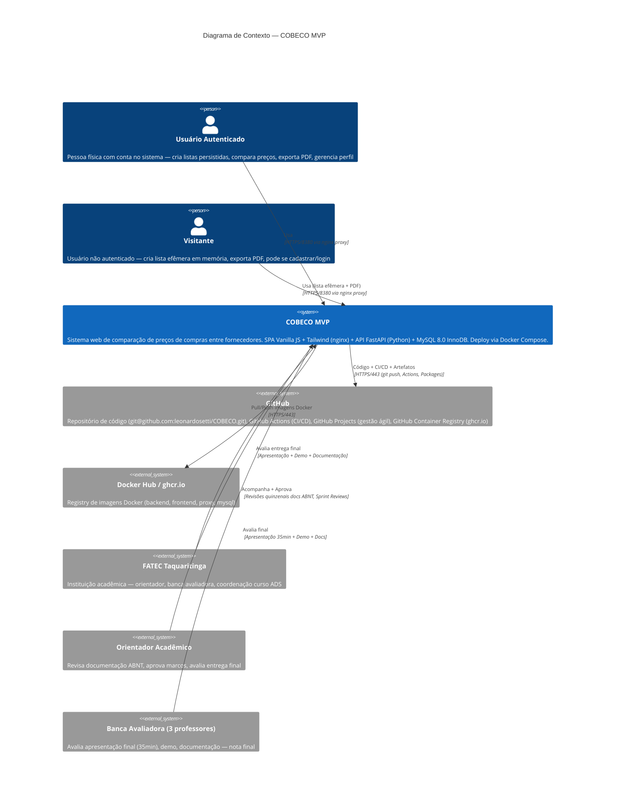

# Diagrama de Contexto (C4 Level 1) — COBECO MVP

**Versão:** 1.0  
**Data:** 15/09/2026  
**Autor:** Nicholas Anthony (Arquiteto)  
**Ferramenta:** Mermaid.js (Docs-as-Code)  
**Base:** ADR-001, Constitution v2.0  
**Status:** Ratificado (Gate 2 — 29/09/2026)

---

## Diagrama Mermaid

---

## Descrição Narrativa

O **COBECO MVP** é um sistema web acessado via browser na porta **8380** (roteada por **nginx** reverso proxy). Dois tipos de atores humanos interagem:

1. **Usuário Autenticado** — Tem conta no sistema (cadastro via RF01). Acesso completo: CRUD de listas persistidas no MySQL, comparação de preços com pré-filtro, exportação PDF, gestão de perfil.
2. **Visitante** — Não tem conta. Pode criar **lista efêmera** em `sessionStorage` (memória do browser), usar autocomplete, exportar PDF. Ao fazer login, pode **promover** a lista efêmera para persistência (RF08/UC17).

O código-fonte vive no **GitHub** (repositório público `leonardosetti/COBECO`). **GitHub Actions** executa CI/CD: `ruff` (lint) + `pytest --cov≥80%` + `mypy` + build Docker. Imagens Docker publicadas no **ghcr.io** (GitHub Container Registry).

A **FATEC Taquaritinga** é a instituição patrocinadora. O **Orientador** acompanha quinzenalmente (Sprint Reviews, docs ABNT). A **Banca** (3 professores) avalia a entrega final: apresentação 35min + demo funcional + documentação ABNT.

---

## Decisões Arquiteturais Relacionadas (ADRs)

| ADR | Título | Impacto no Contexto |
|-----|--------|---------------------|
| ADR-001 | Stack Tecnológica (FastAPI, MySQL, Vanilla JS, nginx, ReportLab) | Define containers L2 e tecnologias de cada ator/sistema |
| ADR-002 | Clean Architecture 4 Camadas (manual) | Define organização interna do Container Backend (L3) |
| ADR-003 | Autenticação JWT + Refresh Cookie httpOnly | Define fluxo de auth entre User/Visitor e Sistema |
| ADR-004 | PDF Server-side ReportLab | Define responsabilidade de exportação no Backend |
| ADR-005 | Seed Determinístico + MySQL InnoDB | Define dados iniciais e constraints de integridade |

---

## Rastreabilidade

| Artefato | Localização |
|----------|-------------|
| Constitution v2.0 | `constitution-0001-constitution-canon-0001-constitution-0001-constitution-canon-canon-0001-constitution-0001-constitution-canon-0001-constitution-0001-constitution-canon-canon-canon-0001-constitution-0001-constitution-canon-0001-constitution-0001-constitution-canon-canon-0001-constitution-0001-constitution-canon-0001-constitution-0001-constitution-canon-canon-canon-canon.md` Art. 1.3, 3.1, 3.7 |
| ADR-001 Stack | `docs/decisoes/doc-adr-0001-stack-decision-v1.0.md` |
| Specs SDD | `.ai/specs/spec-004` a `spec-016` |
| PRD | `docs/strategy/PRD.md` |
| User Stories | `docs/strategy/user-stories/US-*.md` |

---

## Controle de Versões

| Versão | Data | Autor | Mudança | Aprovado por |
|--------|------|-------|---------|--------------|
| 1.0 | 15/09/2026 | Nicholas Anthony | Criação inicial baseada em ADR-001 | CCB (Gate 2) |

---

**Fim do Diagrama de Contexto (C4 Level 1)**  
*Renderize no GitHub/VS Code/Mermaid Live Editor para visualização gráfica. Atualizar a cada ADR/CR arquitetural.*