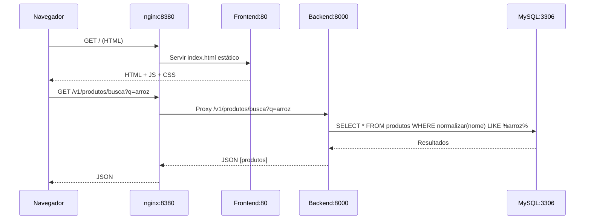

# Diagrama de Containers (C4 Level 2) — COBECO MVP

**Versão:** 1.0  
**Data:** 15/09/2026  
**Autor:** Nicholas Anthony (Arquiteto)  
**Ferramenta:** Mermaid.js (Docs-as-Code)  
**Base:** ADR-001, spec-005 (Container Layers), Constitution v2.0  
**Status:** Ratificado (Gate 2 — 29/09/2026)

---

## Diagrama Mermaid

```mermaid
C4Container
    title Diagrama de Containers — COBECO MVP (Docker Compose)

    Container_Boundary(cobeco_boundary, "COBECO MVP") {
        Container(nginx, "nginx Proxy", "nginx 1.25 (Alpine)", "Reverse proxy porta 8380 (host) → roteia / para frontend (porta 80), /v1/ para backend (porta 8000). Terminação TLS opcional. Health check /health.")
        Container(frontend, "Frontend SPA", "Vanilla JS ES6+ + Tailwind CSS 3.x + nginx (static)", "Single Page Application servida como arquivos estáticos. Roteamento hash-based (#/rota). Estado: sessionStorage (lista efêmera) + memória (access_token). Consome API via proxy.")
        Container(backend, "Backend API", "Python 3.11 + FastAPI + Pydantic + SQLAlchemy 2.0 (async) + Alembic", "REST API + OpenAPI/Swagger automático (/docs). Porta 8000 interna (rede edge). Clean Architecture 4 camadas manual. JWT HS256 + bcrypt salt=12. Rate limit 6/15min. ReportLab PDF.")
        ContainerDb(db, "Banco de Dados", "MySQL 8.0 InnoDB", "8 tabelas PT-BR (usuarios, listas, itens_lista, categorias, fornecedores, fornecedores_categorias, produtos, fornecedores_produtos, precos). ACID, utf8mb4, utf8mb4_unicode_ci. FKs ON DELETE CASCADE/RESTRICT. Soft delete (deletado_em). Porta 3306 interna (rede data).")
    }

    Container_Ext(browser, "Navegador do Usuário", "Chrome / Firefox / Edge (Desktop ≥1024px)", "Renderiza SPA, executa JS, armazena sessionStorage + access_token memória. Faz requisições HTTP/JSON via proxy nginx.")

    Rel(browser, nginx, "HTTPS/8380", "Todas as requisições (HTML, JS, CSS, API /v1/*)")
    Rel(nginx, frontend, "HTTP/80 (interno, container)", "Arquivos estáticos: index.html, app.js, CSS, assets")
    Rel(nginx, backend, "HTTP/8000 (interno, rede edge)", "API REST /v1/* — proxy_pass com headers X-Forwarded-*")
    Rel(backend, db, "TCP/3306 (rede data, interno)", "SQLAlchemy 2.0 async + pymysql driver. Connection pool. Migrations Alembic.")
    
    Rel(backend, github, "HTTPS/443", "GitHub Actions: pull código, push imagens ghcr.io")
    Rel(frontend, github, "HTTPS/443", "GitHub Actions: build, test, push imagens")
    Rel(nginx, github, "HTTPS/443", "GitHub Actions: build, push imagem proxy")

    UpdateLayoutConfig($c4ShapeInRow="3", $c4BoundaryInRow="1")
```

---

## Descrição dos Containers

| Container | Tecnologia | Porta Exposta | Rede Docker | Responsabilidade |
|-----------|------------|---------------|-------------|------------------|
| **nginx Proxy** | nginx 1.25 (Alpine) | **8380 (host)** → 80 (container) | `edge` (entrada) | Reverse proxy, terminação TLS, roteamento `/` → frontend, `/v1/` → backend, health check, headers segurança |
| **Frontend SPA** | Vanilla JS ES6+ + Tailwind 3.x + nginx (static) | 80 (interno) | `edge` (via nginx) | SPA servida estaticamente. Roteamento hash-based. Estado client-side. Consome API via proxy. |
| **Backend API** | Python 3.11 + FastAPI + SQLAlchemy 2.0 + Alembic | 8000 (interno) | `edge` (API), `data` (DB) | REST API + OpenAPI. Clean Architecture 4 camadas. Auth JWT, PDF ReportLab, Seed, Migrations. |
| **MySQL 8.0 InnoDB** | MySQL 8.0 (official) | 3306 (interno) | `data` (isolado) | 8 tabelas PT-BR, ACID, utf8mb4, FKs, soft delete. Apenas backend acessa. |

---

## Redes Docker (Ortogonais — spec-005)

| Rede | Containers | Propósito | Isolamento |
|------|------------|-----------|------------|
| **edge** | nginx, frontend, backend | Tráfego externo ↔ interno. nginx expõe 8380 host. Backend recebe `/v1/` via proxy. | Entrada controlada. Frontend só via nginx. |
| **data** | backend, mysql | Tráfego banco de dados. Apenas backend acessa MySQL. | **Isolamento total** — frontend e nginx **não** têm acesso ao MySQL. |

> **Zero CORS necessário** — Frontend e Backend compartilham mesma origem via nginx proxy (`https://localhost:8380/` e `https://localhost:8380/v1/`).

---

## Fluxo de Requisição Típico



---

## Decisões Arquiteturais (ADRs)

| ADR | Decisão | Impacto nos Containers |
|-----|---------|------------------------|
| ADR-001 | Stack: FastAPI, MySQL, Vanilla JS, nginx, ReportLab | Define 4 containers + tecnologias |
| ADR-002 | Clean Architecture 4 camadas (manual) | Organiza código interno do Backend (L3) |
| ADR-003 | JWT Access (15min, memória) + Refresh (7d, cookie httpOnly) | Auth state no Frontend (memória) + Backend (cookie) |
| ADR-004 | PDF Server-side ReportLab | Backend gera PDF — Frontend só faz download |
| ADR-005 | Seed Determinístico + MySQL InnoDB | MySQL container com dados iniciais fixos |
| spec-005 | Container Layers ortogonais (redes edge/data) | Define redes Docker e isolamento |

---

## Rastreabilidade

| Artefato | Localização |
|----------|-------------|
| ADR-001 | `docs/decisoes/doc-adr-0001-stack-decision-v1.0.md` |
| spec-005 | `.ai/specs/spec-arch-0001-container-layers-v1.0.md` |
| Docker Compose | `config-docker-0001-config-docker-0001-config-docker-0001-config-docker-0001-config-docker-0002-docker-compose-override-v1-v1-v1.0-v1.0-v1.0.yml` |
| config-make-0001-makefile-v1 | `config-make-0001-makefile-v1` (targets `up`, `health`, `logs-*`) |

---

## Controle de Versões

| Versão | Data | Autor | Mudança | Aprovado por |
|--------|------|-------|---------|--------------|
| 1.0 | 15/09/2026 | Nicholas Anthony | Criação inicial baseada em ADR-001 + spec-005 | CCB (Gate 2) |

---

**Fim do Diagrama de Containers (C4 Level 2)**  
*Renderize no GitHub/VS Code/Mermaid Live Editor. Atualizar a cada ADR/CR que mude containers ou redes.*