# Diagrama de Componentes — Backend (C4 Level 3)

**Versão:** 1.0  
**Data:** 15/09/2026  
**Autor:** Nicholas Anthony (Arquiteto)  
**Ferramenta:** Mermaid.js (Docs-as-Code)  
**Base:** ADR-001, ADR-002 (Clean Architecture 4 Camadas), spec-004, Constitution v2.0  
**Status:** Ratificado (Gate 2 — 29/09/2026)

---

## Diagrama Mermaid — Clean Architecture 4 Camadas

```mermaid
C4Component
    title Diagrama de Componentes — Backend COBECO (Clean Architecture 4 Camadas)

    Container_Boundary(backend_boundary, "Backend API (FastAPI)") {
        %% Interface Adapters (Routers/Controllers)
        Component(router_auth, "Auth Router", "FastAPI APIRouter", "POST /v1/auth/login, /register, /logout, /recover, /reset-password")
        Component(router_listas, "Listas Router", "FastAPI APIRouter", "CRUD /v1/listas, /v1/listas/{id}/itens, /v1/listas/{id}/promover")
        Component(router_comparacao, "Comparação Router", "FastAPI APIRouter", "POST /v1/orcamento, GET /v1/categorias, /v1/fornecedores, /v1/produtos/busca")
        Component(router_export, "Export Router", "FastAPI APIRouter", "POST /v1/export/pdf (lista + comparacao)")
        Component(router_perfil, "Perfil Router", "FastAPI APIRouter", "GET/PUT /v1/perfil")
        Component(router_health, "Health Router", "FastAPI APIRouter", "GET /health, /v1/health — readiness/liveness")

        %% Use Cases (Application Layer)
        Component(usecase_cadastrar, "CadastrarUsuario", "Use Case Class", "Valida Pydantic, bcrypt hash, unicidade email/usuario, hash resposta segurança, persiste via UsuarioRepo")
        Component(usecase_login, "Login", "Use Case Class", "Verifica bcrypt, gera JWT access (15min) + refresh (7d, cookie httpOnly), rate limit 6/15min")
        Component(usecase_logout, "Logout", "Use Case Class", "Invalida refresh token (blacklist), limpa cookie")
        Component(usecase_recuperar, "RecuperarSenha", "Use Case Class", "Pergunta segurança (bcrypt) OU RECOVERY_MODE=log (token stdout), reset token 1h")
        Component(usecase_criar_lista, "CriarLista", "Use Case Class", "Valida itens, sessionStorage → entidade Lista")
        Component(usecase_salvar_lista, "SalvarLista", "Use Case Class", "Transação MySQL BEGIN/COMMIT, valida categorias pré-selecionadas, FKs, persiste Lista + ItensLista")
        Component(usecase_promover_lista, "PromoverLista", "Use Case Class", "Reusa SalvarLista com dados da sessionStorage efêmera")
        Component(usecase_listar_listas, "ListarMinhasListas", "Use Case Class", "Paginação 20/pág, ordenação criado_em DESC, filtro nome ILIKE, soft delete")
        Component(usecase_editar_lista, "EditarLista", "Use Case Class", "Update nome/itens (replace all), valida ownership, qtd 1-9999, transação")
        Component(usecase_excluir_lista, "ExcluirLista", "Use Case Class", "Soft delete (deletado_em), confirmação nome exato, ownership")
        Component(usecase_categorias, "SelecionarCategorias", "Use Case Class", "Retorna 11 categorias + contagem produtos, filtra fornecedores por cat")
        Component(usecase_fornecedores, "SelecionarFornecedores", "Use Case Class", "Retorna fornecedores com % disponibilidade nas cat selecionadas, ordena DESC")
        Component(usecase_disponibilidade, "FiltrarDisponibilidade", "Use Case Class", "Filtro local (frontend) — backend apenas fornece dados")
        Component(usecase_calcular, "CalcularOrcamento", "Use Case Class", "Query otimizada JOIN, cache 5min (hash payload), timeout 10s, flat table, melhor fornecedor")
        Component(usecase_resultados, "VisualizarResultados", "Use Case Class", "Formata resposta para frontend: ordenação, highlight, ausentes")
        Component(usecase_export_pdf, "ExportarPDF", "Use Case Class", "ReportLab SimpleDocTemplate, DejaVuSans, A4, templates Lista/Comparação, <5s")
        Component(usecase_visualizar_perfil, "VisualizarPerfil", "Use Case Class", "Retorna campos permitidos: nome_usuario, email, nome, criado_em")
        Component(usecase_gerenciar_perfil, "GerenciarPerfil", "Use Case Class", "Valida senha_atual, email unique, nome, nova_senha bcrypt≠atual≥8, transação ACID, optimistic lock, invalida refresh")

        %% Domain (Entities + Rules)
        Component(entity_usuario, "Usuario", "Domain Entity (dataclass)", "id, nome_usuario, email, senha_hash, pergunta_seguranca, resposta_hash, criado_em, atualizado_em, deletado_em, version")
        Component(entity_lista, "Lista", "Domain Entity", "id, usuario_id, nome, criado_em, atualizado_em, deletado_em, version")
        Component(entity_item_lista, "ItemLista", "Domain Entity", "id, lista_id, produto_id, quantidade, criado_em")
        Component(entity_categoria, "Categoria", "Domain Entity", "id, nome, descricao, criado_em")
        Component(entity_fornecedor, "Fornecedor", "Domain Entity", "id, nome, cnpj, criado_em")
        Component(entity_produto, "Produto", "Domain Entity", "id, nome, categoria_id, unidade, criado_em")
        Component(entity_preco, "Preco", "Domain Entity", "id, fornecedor_id, produto_id, preco, valido_de, valido_ate")
        Component(entity_forn_cat, "FornecedorCategoria", "Domain Entity (Pivot)", "fornecedor_id, categoria_id")
        Component(entity_forn_prod, "FornecedorProduto", "Domain Entity (Pivot)", "fornecedor_id, produto_id")

        Component(rule_auth, "Auth Rules", "Domain Services", "Validar unicidade email/usuario, bcrypt hash/verify, JWT generate/validate, rate limit")
        Component(rule_lista, "Lista Rules", "Domain Services", "Validar qtd 1-9999, soma mesmo produto, ownership, categorias pré-selecionadas")
        Component(rule_comparacao, "Comparacao Rules", "Domain Services", "Calcular flat table, cache key, timeout, melhor fornecedor (menor total), economia")
        Component(rule_pdf, "PDF Rules", "Domain Services", "Template Lista/Comparação, DejaVuSans, keepTogether, header repeat, <5s")
        Component(rule_perfil, "Perfil Rules", "Domain Services", "Senha_atual obrigatória, email unique, nova_senha≠atual≥8, invalidação refresh")

        %% Infrastrdoc-arch-0006-uc-v1ture Adapters
        Component(adapter_usuario_repo, "UsuarioRepository", "SQLAlchemy 2.0 Async", "CRUD Usuario, find_by_email, find_by_nome_usuario, find_by_id")
        Component(adapter_lista_repo, "ListaRepository", "SQLAlchemy 2.0 Async", "CRUD Lista, find_by_usuario_paginado, soft_delete, update_itens_replace_all")
        Component(adapter_produto_repo, "ProdutoRepository", "SQLAlchemy 2.0 Async", "Busca normalizada (ILIKE + normalizar), find_by_categoria")
        Component(adapter_fornecedor_repo, "FornecedorRepository", "SQLAlchemy 2.0 Async", "Find by categorias, % disponibilidade")
        Component(adapter_preco_repo, "PrecoRepository", "SQLAlchemy 2.0 Async", "Precos vigentes por fornecedor+produto, cache 5min")
        Component(adapter_pdf, "PDFAdapter", "ReportLab", "SimpleDocTemplate, DejaVuSans, A4, templates Lista/Comparação, streaming se >200 itens")
        Component(adapter_auth, "AuthAdapter", "python-jose + passlib", "JWT HS256 encode/decode, bcrypt hash/verify (salt=12), cookie httpOnly SameSite=Strict")
        Component(adapter_cache, "CacheAdapter", "In-memory dict + TTL", "Cache 5min para /v1/orcamento (key=SHA256(payload)), invalidação em preco_atualizado")

        %% Infrastrdoc-arch-0006-uc-v1ture (Config, Migrations, Seed)
        Component(infra_config, "Config", "Pydantic Settings", "config-env-0001-env-example-v1.0 → Settings (DB_URL, SECRET_KEY, JWT_ALGORITHM, ACCESS_EXP, REFRESH_EXP, RECOVERY_MODE)")
        Component(infra_migrations, "Migrations", "Alembic", "Versionamento schema, upgrade/downgrade, autogenerate")
        Component(infra_seed, "Seed", "Script Python", "Popula 11 cat, 10 forn, 50 prod, ~300 precos <10s, bulk_insert, determinístico")
    }

    ContainerDb(db, "MySQL 8.0 InnoDB", "Banco de Dados", "8 tabelas PT-BR, ACID, utf8mb4, FKs, soft delete")

    %% Relationships — Routers → UseCases
    Rel(router_auth, usecase_cadastrar, "Chama")
    Rel(router_auth, usecase_login, "Chama")
    Rel(router_auth, usecase_logout, "Chama")
    Rel(router_auth, usecase_recuperar, "Chama")
    Rel(router_listas, usecase_criar_lista, "Chama")
    Rel(router_listas, usecase_salvar_lista, "Chama")
    Rel(router_listas, usecase_promover_lista, "Chama")
    Rel(router_listas, usecase_listar_listas, "Chama")
    Rel(router_listas, usecase_editar_lista, "Chama")
    Rel(router_listas, usecase_excluir_lista, "Chama")
    Rel(router_comparacao, usecase_categorias, "Chama")
    Rel(router_comparacao, usecase_fornecedores, "Chama")
    Rel(router_comparacao, usecase_calcular, "Chama")
    Rel(router_export, usecase_export_pdf, "Chama")
    Rel(router_perfil, usecase_visualizar_perfil, "Chama")
    Rel(router_perfil, usecase_gerenciar_perfil, "Chama")
    Rel(router_health, infra_config, "Lê config para health check")

    %% UseCases → Domain Entities + Rules
    Rel(usecase_cadastrar, entity_usuario, "Cria/Usa")
    Rel(usecase_cadastrar, rule_auth, "Valida")
    Rel(usecase_login, entity_usuario, "Busca/Valida")
    Rel(usecase_login, rule_auth, "bcrypt + JWT + rate limit")
    Rel(usecase_logout, rule_auth, "Invalida refresh")
    Rel(usecase_recuperar, entity_usuario, "Busca/Valida resposta")
    Rel(usecase_recuperar, rule_auth, "bcrypt resposta OU token stdout")
    Rel(usecase_salvar_lista, entity_lista, "Cria")
    Rel(usecase_salvar_lista, entity_item_lista, "Cria itens")
    Rel(usecase_salvar_lista, rule_lista, "Valida categorias, qtd, ownership")
    Rel(usecase_promover_lista, usecase_salvar_lista, "Reusa")
    Rel(usecase_listar_listas, entity_lista, "Busca paginada")
    Rel(usecase_editar_lista, entity_lista, "Update")
    Rel(usecase_editar_lista, entity_item_lista, "Replace all")
    Rel(usecase_editar_lista, rule_lista, "Valida ownership, qtd")
    Rel(usecase_excluir_lista, entity_lista, "Soft delete")
    Rel(usecase_excluir_lista, rule_lista, "Confirmação nome, ownership")
    Rel(usecase_categorias, entity_categoria, "Retorna todas + contagem")
    Rel(usecase_categorias, entity_fornecedor, "Filtra por cat")
    Rel(usecase_fornecedores, entity_fornecedor, "Retorna + % disponibilidade")
    Rel(usecase_calcular, entity_produto, "Busca precos")
    Rel(usecase_calcular, entity_fornecedor, "Agrupa por fornecedor")
    Rel(usecase_calcular, rule_comparacao, "Flat table, cache, timeout, melhor")
    Rel(usecase_export_pdf, rule_pdf, "Gera PDF ReportLab")
    Rel(usecase_visualizar_perfil, entity_usuario, "Retorna campos permitidos")
    Rel(usecase_gerenciar_perfil, entity_usuario, "Update campos")
    Rel(usecase_gerenciar_perfil, rule_perfil, "Valida senha_atual, unique, bcrypt, lock")

    %% UseCases → Adapters (Repositories, PDF, Auth, Cache)
    Rel(usecase_cadastrar, adapter_usuario_repo, "Persiste")
    Rel(usecase_login, adapter_usuario_repo, "Busca")
    Rel(usecase_login, adapter_auth, "Gera/Valida JWT")
    Rel(usecase_logout, adapter_auth, "Blacklist refresh")
    Rel(usecase_recuperar, adapter_usuario_repo, "Busca/Atualiza")
    Rel(usecase_salvar_lista, adapter_lista_repo, "Transação: Lista + Itens")
    Rel(usecase_listar_listas, adapter_lista_repo, "Busca paginada")
    Rel(usecase_editar_lista, adapter_lista_repo, "Update + Replace Itens")
    Rel(usecase_excluir_lista, adapter_lista_repo, "Soft delete")
    Rel(usecase_categorias, adapter_produto_repo, "Contagem por categoria")
    Rel(usecase_categorias, adapter_fornecedor_repo, "Filtra por cat")
    Rel(usecase_fornecedores, adapter_fornecedor_repo, "Busca + % disp")
    Rel(usecase_calcular, adapter_preco_repo, "Preços vigentes (cache 5min)")
    Rel(usecase_calcular, adapter_cache, "GET/SET cache 5min")
    Rel(usecase_export_pdf, adapter_pdf, "Gera PDF bytes")
    Rel(usecase_visualizar_perfil, adapter_usuario_repo, "Busca por ID")
    Rel(usecase_gerenciar_perfil, adapter_usuario_repo, "Update transacional")
    Rel(usecase_gerenciar_perfil, adapter_auth, "Invalida refresh tokens")

    %% Adapters → Database
    Rel(adapter_usuario_repo, db, "SQLAlchemy async + pymysql")
    Rel(adapter_lista_repo, db, "SQLAlchemy async + pymysql")
    Rel(adapter_produto_repo, db, "SQLAlchemy async + pymysql")
    Rel(adapter_fornecedor_repo, db, "SQLAlchemy async + pymysql")
    Rel(adapter_preco_repo, db, "SQLAlchemy async + pymysql")
    Rel(infra_migrations, db, "Alembic upgrade/downgrade")
    Rel(infra_seed, db, "Bulk insert determinístico")

    UpdateLayoutConfig($c4ShapeInRow="4", $c4BoundaryInRow="1")
```

---

## Descrição das Camadas (Clean Architecture Manual)

| Camada | Componentes | Responsabilidade | Regra de Ouro |
|--------|-------------|------------------|---------------|
| **1. Interface Adapters (Routers)** | 6 Routers + Health | Recebem HTTP, validam input (Pydantic), chamam UseCases, retornam HTTP | **Nunca** contêm regra de negócio. Apenas serialização/deserialização. |
| **2. Use Cases (Application)** | 20+ Classes | Orquestram fluxo: validam input, chamam Domain Rules, chamam Adapters, gerenciam transações | **Coração da aplicação**. Uma classe por fluxo de usuário (UC). Transações aqui. |
| **3. Domain (Entities + Rules)** | 10 Entities + 5 Rule Services | Regras de negócio puras, invariantes, validações independentes de framework | **Zero dependência** de FastAPI, SQLAlchemy, Pydantic. Apenas Python stdlib + dataclasses. |
| **4. Infrastrdoc-arch-0006-uc-v1ture Adapters** | 8 Adapters | Implementam interfaces do Domain: Repositories (SQLAlchemy), PDF (ReportLab), Auth (python-jose), Cache | **Detalhes de implementação**. Podem ser trocados sem afetar Domain/UseCases. |

---

## Princípios Arquiteturais (Constitution + ADR-002)

| Princípio | Implementação no Backend |
|-----------|--------------------------|
| **Dependency Rule** | Domain → UseCases → Adapters → Routers. **Nunca** inverso. |
| **Single Responsibility** | Um UseCase por fluxo (UC). Um Repository por Entidade. |
| **Transaction Boundary** | Transações **apenas** em UseCases (BEGIN/COMMIT/ROLLBACK explícito). |
| **Parameterized Queries** | SQLAlchemy ORM + async — **zero** SQL raw / f-strings. |
| **PT-BR Naming** | Entidades, campos, tabelas, variáveis, erros — tudo em português. |
| **Testability** | UseCases recebem Adapters por injeção (constrdoc-arch-0006-uc-v1tor) — mockável em testes. |
| **No Framework Leak** | Domain não importa FastAPI, Pydantic, SQLAlchemy. Apenas `dataclasses`, `datetime`, `decimal`. |

---

## Mapeamento UseCase ↔ User Story ↔ RF

| UseCase | User Story | RF | Endpoint(s) |
|---------|------------|----|-------------|
| CadastrarUsuario | US-001 | RF01 | POST /v1/auth/register |
| Login | US-002 | RF02 | POST /v1/auth/login |
| Logout | US-003 | RF03 | POST /v1/auth/logout |
| RecuperarSenha | US-004 | RF04 | POST /v1/auth/recover, /reset-password |
| CriarLista | US-005 | RF07 | (Frontend only — sessionStorage) |
| SalvarLista | US-007 | RF08 | POST /v1/listas |
| PromoverLista | US-008 | RF08 | POST /v1/listas (reusa) |
| ListarMinhasListas | US-009 | RF09 | GET /v1/listas |
| EditarLista | US-010 | RF10 | PUT /v1/listas/{id}, PUT /v1/listas/{id}/itens |
| ExcluirLista | US-011 | RF11 | DELETE /v1/listas/{id} |
| SelecionarCategorias | US-012 | RF12 | GET /v1/categorias, GET /v1/fornecedores?categorias= |
| SelecionarFornecedores | US-013 | RF13 | GET /v1/fornecedores?categorias= |
| FiltrarDisponibilidade | US-014 | RF14 | (Frontend local — slider) |
| CalcularOrcamento | US-015 | RF15 | POST /v1/orcamento |
| VisualizarResultados | US-016 | RF16 | (Frontend consome resposta do orcamento) |
| ExportarPDF | US-017 | RF17 | POST /v1/export/pdf |
| VisualizarPerfil | US-019 | RF05 | GET /v1/perfil |
| GerenciarPerfil | US-020 | RF06 | PUT /v1/perfil |

---

## Decisões Técnicas Chave (ADRs)

| ADR | Decisão | Componente Afetado |
|-----|---------|-------------------|
| ADR-001 | Stack: FastAPI, SQLAlchemy 2.0, MySQL, ReportLab | Todos |
| ADR-002 | Clean Architecture 4 camadas (manual) | Estrutura de pastas `domain/`, `usecases/`, `adapters/`, `infrastrdoc-arch-0006-uc-v1ture/`, `api/` |
| ADR-003 | JWT Access (15min, memória) + Refresh (7d, cookie httpOnly) | `AuthAdapter`, `AuthUseCases`, `AuthRouter` |
| ADR-004 | PDF Server-side ReportLab | `PDFAdapter`, `ExportarPDFUseCase`, `ExportRouter` |
| ADR-005 | Seed Determinístico + MySQL InnoDB | `infra_seed`, `Migrations`, `MySQL Container` |

---

## Rastreabilidade

| Artefato | Localização |
|----------|-------------|
| Constitution v2.0 | `constitution-0001-constitution-canon-0001-constitution-0001-constitution-canon-canon-0001-constitution-0001-constitution-canon-0001-constitution-0001-constitution-canon-canon-canon-0001-constitution-0001-constitution-canon-0001-constitution-0001-constitution-canon-canon-0001-constitution-0001-constitution-canon-0001-constitution-0001-constitution-canon-canon-canon-canon.md` Art. 3.1 (KISS), 3.7 (YAGNI), 6 (SDD) |
| ADR-001 | `docs/decisoes/doc-adr-0001-stack-decision-v1.0.md` |
| ADR-002 | `docs/decisoes/ADR-002-clean-architecture.md` (a criar) |
| Spec-004 | `.ai/specs/spec-tech-0001-backend-mvp-v1.0.md` |
| Spec-008 | `.ai/specs/spec-ui-0001-frontend-web-responsive-v1.0.md` |
| Handoffs | `.ai/handoffs/HF-0500` a `HF-0617` |
| Código Fonte | `backend/src/` (estrutura 4 camadas) |

---

## Controle de Versões

| Versão | Data | Autor | Mudança | Aprovado por |
|--------|------|-------|---------|--------------|
| 1.0 | 15/09/2026 | Nicholas Anthony | Criação inicial baseada em ADR-001/002 + spec-004 | CCB (Gate 2) |

---

**Fim do Diagrama de Componentes — Backend (C4 Level 3)**  
*Renderize no GitHub/VS Code/Mermaid Live Editor. Atualizar a cada ADR/CR que mude componentes ou regras de negócio.*