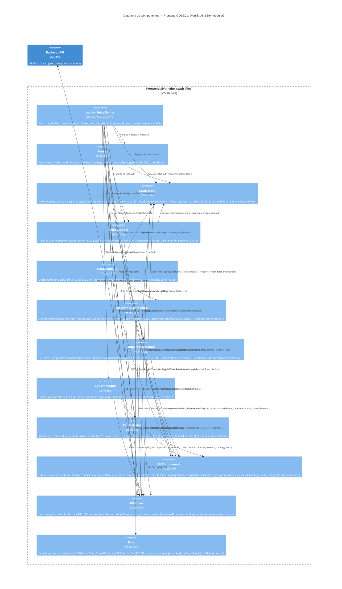
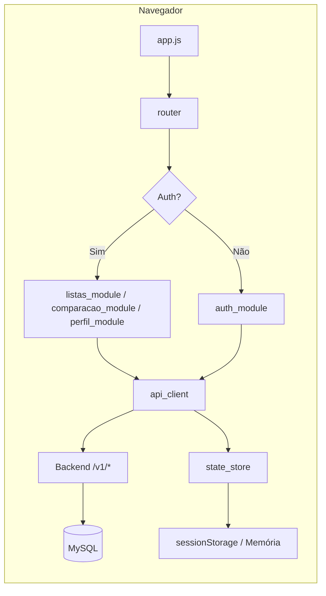

# Diagrama de Componentes — Frontend (C4 Level 3)

**Versão:** 1.0  
**Data:** 15/09/2026  
**Autor:** Nicholas Anthony (Arquiteto) + Eduardo Passarelli (Dev Frontend)  
**Ferramenta:** Mermaid.js (Docs-as-Code)  
**Base:** ADR-001, spec-008, Constitution v2.0 (KISS, YAGNI, Desktop-first)  
**Status:** Ratificado (Gate 2 — 29/09/2026)

---

## Diagrama Mermaid — Arquitetura Modular Vanilla JS



---

## Descrição dos Módulos (Vanilla JS ES6+)

| Módulo | Arquivo | Responsabilidade | Padrão |
|--------|---------|------------------|--------|
| **app.js** | `app.js` | Entry point, bootstrap, roteamento, estado global | IIFE + Module Pattern |
| **router** | `router.js` | Hash-based routing (`#/rota`), guards auth, histórico | State Machine simples |
| **state_store** | `store.js` | sessionStorage (persistente) + memória (volátil), eventos `CustomEvent` | Observer Pattern |
| **auth_module** | `modules/auth.js` | Login, Cadastro, Recuperar, Logout — forms + validação + fetch | Page Controller |
| **listas_module** | `modules/listas.js` | Dashboard, Nova Lista, Editar — CRUD UI completo | Page Controller |
| **autocomplete_module** | `components/autocomplete.js` | Input + dropdown, debounce, normalização, seleção | Reusable Component |
| **comparacao_module** | `modules/comparacao.js` | Pré-filtro (3 etapas), Cálculo, Resultados | Page Controller + Wizard |
| **export_module** | `components/export.js` | PDF download, filename, toast | Utility Component |
| **perfil_module** | `modules/perfil.js` | Visualizar (read-only) + Editar (3 forms) | Page Controller |
| **ui_components** | `components/ui/*.js` | Toast, Skeleton, Modal, LoadingOverlay, Badge | Design System mínimo |
| **api_client** | `api/client.js` | Fetch wrapper, interceptors (auth, refresh, error), retry | Singleton |
| **utils** | `utils/*.js` | Funções puras: normalizar, currency, date, debounce, validação | Functional |

---

## Fluxo de Dados (Data Flow)



---

## Roteamento (Hash-based)

| Rota | Módulo | Auth | Descrição |
|------|--------|------|-----------|
| `#/` | Redirect → `#/listas` (auth) ou `#/login` | — | Home |
| `#/login` | auth_module | Público | Login + aba Cadastro |
| `#/cadastro` | auth_module | Público | Cadastro (mesma página, tab) |
| `#/recuperar` | auth_module | Público | Solicitar recuperação |
| `#/redefinir?token=...` | auth_module | Público | Redefinir senha |
| `#/listas` | listas_module (Dashboard) | **Obrigatório** | Minhas listas (paginado, busca) |
| `#/listas/nova` | listas_module (Nova) | **Obrigatório** | Criar lista + autocomplete |
| `#/listas/{id}/editar` | listas_module (Editar) | **Obrigatório** | Editar nome/itens |
| `#/comparacao` | comparacao_module (Etapa 1: Categorias) | Opcional | Selecionar categorias |
| `#/comparacao/fornecedores` | comparacao_module (Etapa 2: Fornecedores) | Opcional | Selecionar fornecedores + slider |
| `#/resultado` | comparacao_module (Resultados) | Opcional | Tabela + exportar/imprimir |
| `#/perfil` | perfil_module (Visualizar) | **Obrigatório** | Dados read-only |
| `#/perfil/editar` | perfil_module (Editar) | **Obrigatório** | 3 forms: Email, Nome, Senha |

> **Guards:** Rotas "Obrigatório" verificam `state_store.hasAccessToken()` — se falso, redirect `#/login?next=...`.

---

## Gerenciamento de Estado (State Store)

| Chave sessionStorage | Conteúdo | TTL | Usado Por |
|----------------------|----------|-----|-----------|
| `cobeco_lista_efemera` | `{nome, itens: [{produto_id, quantidade, ...}]}` | Sessão | listas_module (Nova Lista, Promoção) |
| `cobeco_categorias_selecionadas` | `[categoria_id, ...]` | Sessão | comparacao_module |
| `cobeco_fornecedores_selecionados` | `[fornecedor_id, ...]` | Sessão | comparacao_module |
| `cobeco_orcamento_resultado` | `{fornecedores: [...], melhor_id, ...}` | Sessão | comparacao_module (Resultados) |

| Variável Memória (Volátil) | Conteúdo | Usado Por |
|----------------------------|----------|-----------|
| `accessToken` | JWT string (15min) | api_client (Authorization header) |
| `userData` | `{nome_usuario, email, nome, criado_em}` | perfil_module, ui_components |
| `refreshTokenPromise` | Promise de refresh em andamento | api_client (evita race condition) |

> **Reatividade:** `state_store` emite `CustomEvent('state:changed', {key, value})` — módulos ouvem via `addEventListener`.

---

## API Client (Singleton)

```javascript
// api/client.js — principios
const api = {
  baseURL: '/v1',
  async request(method, path, body) {
    const headers = { 'Content-Type': 'application/json' };
    if (state_store.getAccessToken()) headers.Authorization = `Bearer ${state_store.getAccessToken()}`;
    
    const response = await fetch(`${this.baseURL}${path}`, { method, headers, body: JSON.stringify(body) });
    
    if (response.status === 401) {
      // Tentar refresh automático (uma vez)
      if (!this._refreshing) {
        this._refreshing = true;
        await this.refreshToken();
        this._refreshing = false;
        return this.request(method, path, body); // retry
      } else {
        state_store.clearAuth(); // logout forçado
        router.navigate('#/login');
        throw new Error('Sessão expirada');
      }
    }
    return response.json();
  },
  refreshToken: async () => { /* POST /v1/auth/refresh com cookie */ }
};
```

---

## UI Components (Design System Mínimo)

| Componente | Arquivo | Props/API | Uso |
|------------|---------|-----------|-----|
| **Toast** | `components/ui/toast.js` | `show(message, type: 'sdoc-arch-0006-uc-v1cess'|'error'|'info', duration=3000)` | Global — `ui.toast.sdoc-arch-0006-uc-v1cess('Salvo!')` |
| **Skeleton** | `components/ui/skeleton.js` | `render(container, rows=5, cols=4)` | Tabelas/listas loading |
| **Modal** | `components/ui/modal.js` | `open({title, body, confirmText, onConfirm, cancelText, onCancel})` | Confirmações, promoção, exclusão |
| **LoadingOverlay** | `components/ui/loading.js` | `show()/hide()` | Full-screen spinner |
| **Badge** | `components/ui/badge.js` | `render(text, variant: 'green'|'yellow'|'red')` | % disponibilidade |
| **Autocomplete** | `components/autocomplete.js` | `new Autocomplete(inputEl, {fetchUrl, onSelect, debounce=300})` | Listas, Editar |
| **DataTable** | `components/datatable.js` | `render(container, {columns, data, expandable, onExpand})` | Dashboard, Resultados |

---

## Convenções Frontend (Constitution + ADR-001)

| Regra | Implementação |
|-------|---------------|
| **Vanilla JS ES6+** | Modules (`import`/`export`), `const`/`let`, arrow functions, `async`/`await`, `fetch` |
| **Zero Build Step** | Arquivos servidos diretamente por nginx — sem Vite/Webpack/Babel |
| **Desktop-first ≥1024px** | Media queries `min-width: 1024px` — mobile não suportado (RNF04) |
| **Tailwind CSS 3.x** | Via CDN ou build local — classes utilitárias, design system consistente |
| **PT-BR** | Variáveis, comentários, strings, mensagens de erro — tudo em português |
| **Acessibilidade Básica** | `aria-label`, `role`, `tabindex`, foco visível, cores contraste WCAG AA |
| **Normalização** | `normalizar(str) = str.normalize('NFD').replace(/[\u0300-\u036f]/g, '').toLowerCase()` — client + server |
| **Debounce Padrão** | 300ms (busca), 100ms (slider), 200ms (checkboxes) |
| **sessionStorage** | Chave prefixada `cobeco_*` — sobrevive a refresh/F5, limpa ao fechar aba |

---

## Rastreabilidade

| Artefato | Localização |
|----------|-------------|
| ADR-001 | `docs/decisoes/doc-adr-0001-stack-decision-v1.0.md` |
| spec-008 | `.ai/specs/spec-ui-0001-frontend-web-responsive-v1.0.md` |
| Spec-010 | `.ai/specs/spec-quality-0001-qualidade-pdca-ishikawa-v1.0.md` (feedback visual) |
| Código Fonte | `frontend/` (estrutura modular) |
| User Stories | `docs/strategy/user-stories/doc-user-story-0005-us-005` a `doc-user-story-0020-us-020` |

---

## Controle de Versões

| Versão | Data | Autor | Mudança | Aprovado por |
|--------|--------|-------|---------|--------------|
| 1.0 | 15/09/2026 | Nicholas Anthony + Eduardo Passarelli | Criação inicial baseada em ADR-001 + spec-008 | CCB (Gate 2) |

---

**Fim do Diagrama de Componentes — Frontend (C4 Level 3)**  
*Renderize no GitHub/VS Code/Mermaid Live Editor. Atualizar a cada ADR/CR que mude módulos ou fluxos frontend.*