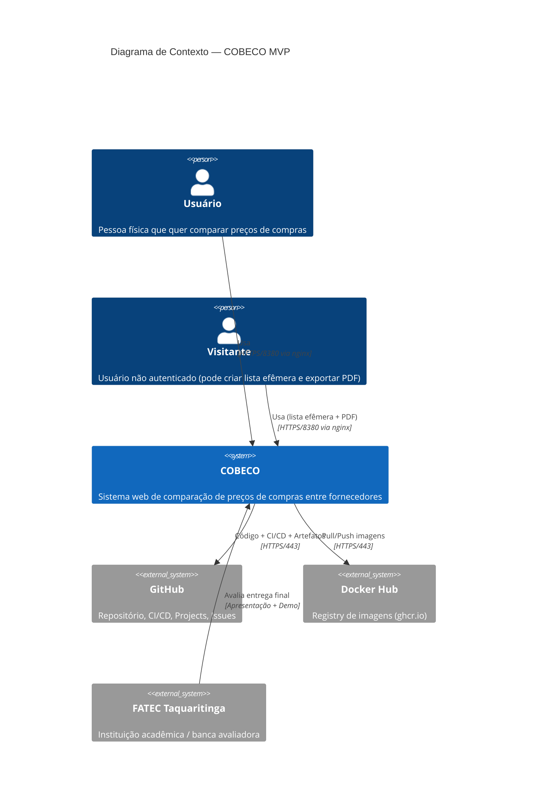
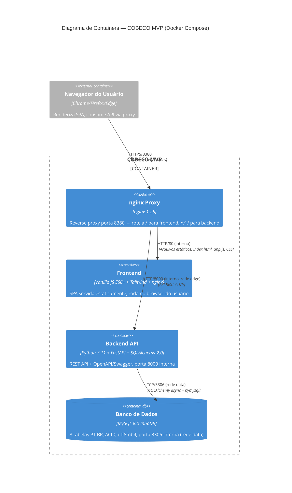
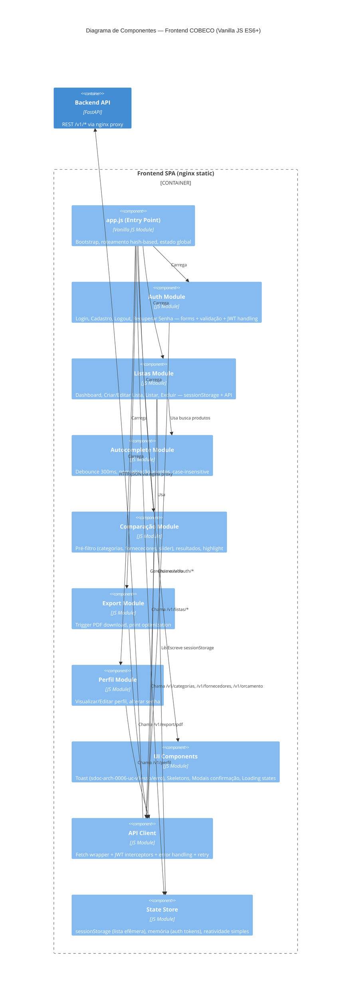
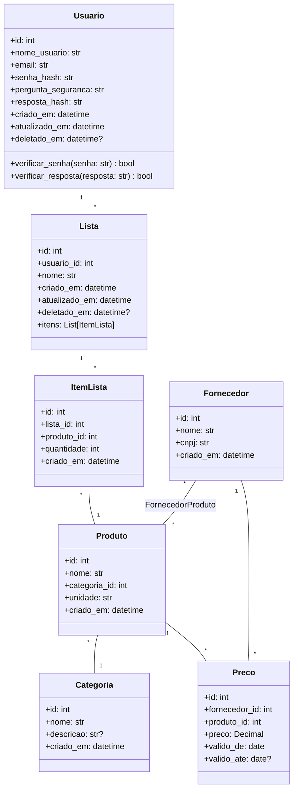

# Diagramas C4 — <NOME DO PROJETO>

**Versão:** 1.0  
**Data:** DD/MM/AAAA  
**Autor:** Arquiteto de Software  
**Ferramenta:** Mermaid.js (Docs-as-Code, versionado no Git)  
**Base:** ADR-001, Constitution v2.0, spec-005 (Container Layers)  
**Níveis:** Contexto (L1) → Containers (L2) → Componentes (L3) → Código (L4 - opcional)

---

## 1. Diagrama de Contexto (Level 1) — Sistema no Ecossistema

**Descrição:** O COBECO é um sistema web acessado via browser (porta 8380 roteada por nginx). Usuários autenticados têm acesso completo (CRUD listas, comparação, perfil, PDF). Visitantes podem criar listas efêmeras em memória e exportar PDF. O código vive no GitHub com CI/CD automatizado. Imagens Docker no ghcr.io. A FATEC avalia a entrega final.

---

## 2. Diagrama de Containers (Level 2) — Arquitetura de Deploy

**Descrição:** Arquitetura de 4 containers ortogonais (spec-005). Rede `edge` expõe nginx (porta 8380 host). Rede `data` isola MySQL (apenas backend acessa). Frontend servido como arquivos estáticos pelo nginx. Backend FastAPI na porta 8000 interna. Zero CORS necessário (mesma origem via proxy).

---

## 3. Diagrama de Componentes (Level 3) — Backend (FastAPI)

```mermaid
C4Component
    title Diagrama de Componentes — Backend COBECO (Clean Architecture 4 Camadas)

    Container_Boundary(backend_boundary, "Backend API (FastAPI)") {
        Component(router_auth, "Auth Router", "FastAPI Router", "POST /v1/auth/login, /register, /logout, /recover")
        Component(router_listas, "Listas Router", "FastAPI Router", "CRUD /v1/listas, /v1/listas/{id}/itens")
        Component(router_comparacao, "Comparação Router", "FastAPI Router", "POST /v1/orcamento, GET /v1/categorias, /v1/fornecedores")
        Component(router_export, "Export Router", "FastAPI Router", "POST /v1/export/pdf")
        Component(router_perfil, "Perfil Router", "FastAPI Router", "GET/PUT /v1/perfil")

        Component(usecase_auth, "Auth UseCases", "Python Classes", "CadastrarUsuario, Login, Logout, RecuperarSenha")
        Component(usecase_listas, "Listas UseCases", "Python Classes", "CriarLista, SalvarLista, ListarListas, EditarLista, ExcluirLista, PromoverLista")
        Component(usecase_comparacao, "Comparação UseCases", "Python Classes", "SelecionarCategorias, SelecionarFornecedores, FiltrarDisponibilidade, CalcularOrcamento, VisualizarResultados")
        Component(usecase_export, "Export UseCases", "Python Classes", "ExportarPDF")
        Component(usecase_perfil, "Perfil UseCases", "Python Classes", "VisualizarPerfil, GerenciarPerfil")

        Component(domain_entities, "Domain Entities", "Python Dataclasses", "Usuario, Lista, ItemLista, Categoria, Fornecedor, Produto, Preco")
        Component(domain_rules, "Domain Rules", "Python Functions", "Validações de negócio: unicidade, senha, cálculos, ACID")

        Component(adapter_db, "Database Adapter", "SQLAlchemy 2.0 + Alembic", "Repositories: UsuarioRepo, ListaRepo, ProdutoRepo, PrecoRepo")
        Component(adapter_pdf, "PDF Adapter", "ReportLab", "Gera PDF A4 server-side")
        Component(adapter_auth, "Auth Adapter", "python-jose + passlib", "JWT HS256, bcrypt salt=12, cookies httpOnly")

        Component(infra_config, "Config", "Pydantic Settings", "config-env-0001-env-example-v1.0 → Settings (DB_URL, SECRET_KEY, JWT_*)")
        Component(infra_migrations, "Migrations", "Alembic", "Versionamento de schema")
        Component(infra_seed, "Seed", "Python Script", "Popula 11 cat, 10 forn, 50 prod, 300 preços")
    }

    ContainerDb(db, "MySQL 8.0 InnoDB", "Banco de Dados", "8 tabelas PT-BR")

    Rel(router_auth, usecase_auth, "Chama")
    Rel(router_listas, usecase_listas, "Chama")
    Rel(router_comparacao, usecase_comparacao, "Chama")
    Rel(router_export, usecase_export, "Chama")
    Rel(router_perfil, usecase_perfil, "Chama")

    Rel(usecase_auth, domain_entities, "Usa")
    Rel(usecase_auth, domain_rules, "Valida")
    Rel(usecase_auth, adapter_db, "Persiste via Repo")
    Rel(usecase_auth, adapter_auth, "Gera/Valida tokens")

    Rel(usecase_listas, domain_entities, "Usa")
    Rel(usecase_listas, domain_rules, "Valida")
    Rel(usecase_listas, adapter_db, "Persiste via Repo")

    Rel(usecase_comparacao, domain_entities, "Usa")
    Rel(usecase_comparacao, domain_rules, "Calcula orçamento")
    Rel(usecase_comparacao, adapter_db, "Lê via Repo (cache 5min)")

    Rel(usecase_export, adapter_pdf, "Gera PDF")
    Rel(usecase_export, adapter_db, "Lê dados da lista")

    Rel(usecase_perfil, domain_entities, "Usa")
    Rel(usecase_perfil, adapter_db, "Persiste via Repo (ACID)")

    Rel(adapter_db, db, "SQLAlchemy async + pymysql")
```

**Descrição:** Clean Architecture manual (4 camadas) imposta por convenção + code review (ADR-001). Routers → UseCases → Domain (Entities + Rules) → Adapters (DB, PDF, Auth) → Infra. Nenhuma dependência de framework no Domain.

---

## 4. Diagrama de Componentes (Level 3) — Frontend (Vanilla JS)

**Descrição:** Arquitetura modular Vanilla JS (sem build step). Roteamento hash-based (`#/rota`). Estado em `sessionStorage` para lista efêmera + memória para tokens. API client centralizado com interceptors para JWT. UI components reutilizáveis (Toast, Skeletons, Modais).

---

## 5. Diagrama de Código (Level 4) — Exemplo (Opcional)

> **Nota:** Nível 4 é gerado a partir do código (ex.: `pyreverse`, `madge`) e não versionado manualmente. Incluir aqui apenas se necessário para auditoria.

---

## 6. Decisões Arquiteturais Registradas (ADRs)

| ADR | Título | Status | Impacto no C4 |
|-----|--------|--------|---------------|
| ADR-001 | Stack Tecnológica (FastAPI, MySQL, Vanilla JS) | Ratificada | Define containers L2 + componentes L3 |
| ADR-002 | Clean Architecture 4 Camadas (manual) | Pendente | Define componentes L3 backend |
| ADR-003 | Autenticação JWT + Refresh Cookie | Pendente | Define Auth Adapter + Router |
| ADR-004 | PDF Server-side com ReportLab | Pendente | Define Export Adapter |
| ADR-005 | Seed Determinístico + MySQL InnoDB | Pendente | Define Infra Seed + DB Container |

---

## 7. Convenções de Diagramas C4 no Projeto

1. **Ferramenta:** Mermaid.js (`.md` no repo) — renderiza no GitHub/GitLab/VS Code
2. **Localização:** `docs/arquitetura/C4-<level>-<nome>.md`
3. **Nomenclatura:** `C4-Context.md`, `C4-Containers.md`, `C4-Components-Backend.md`, `C4-Components-Frontend.md`
4. **Atualização:** Sempre que houver ADR ratificado ou CR que mude arquitetura
5. **Validação:** CI check — Mermaid syntax válido (`markdownlint` + custom script)

---

## 8. Controle de Versões

| Versão | Data | Autor | Mudança | Aprovado por |
|--------|------|-------|---------|--------------|
| 1.0 | DD/MM/AAAA | Arquiteto | Criação inicial baseada em ADR-001 + spec-005 | CCB (Gate 2) |

---

**Fim dos Diagramas C4**  
*Renderize no GitHub/VS Code para visualização gráfica. Atualizar a cada ADR/CR arquitetural.*