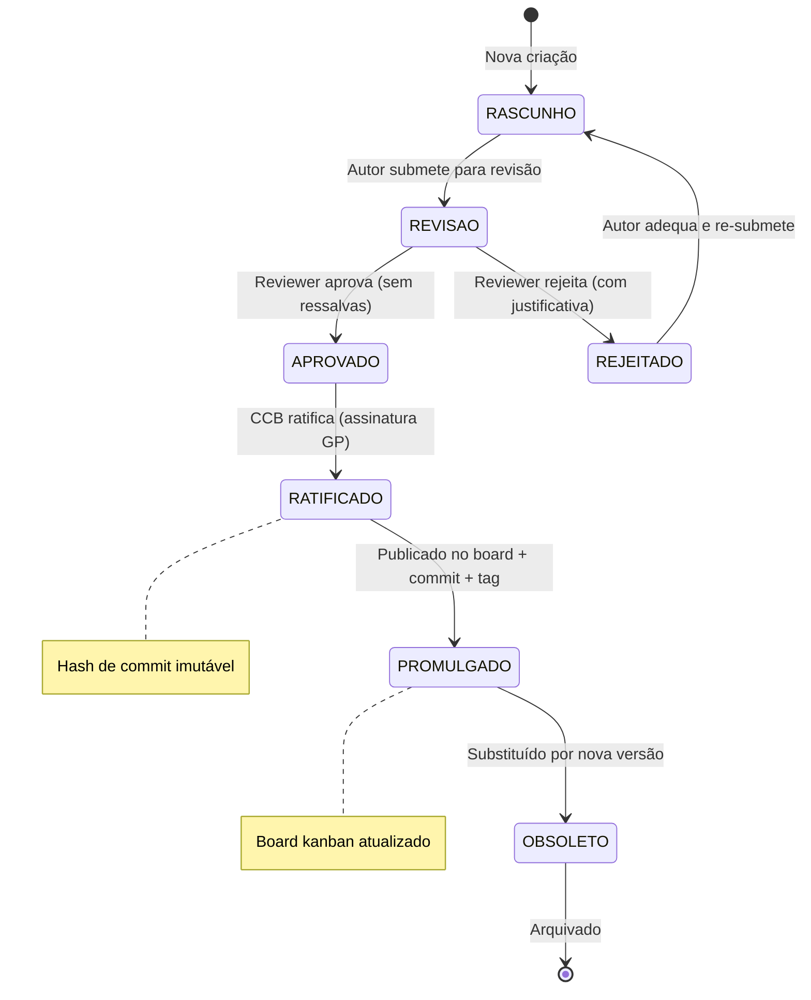

# 📋 PROPOSTA: PROTOCOLO DE NORMATIZAÇÃO DE ARTEFATOS — COBECO MVP
**Versão:** 1.0 | **Data:** 14/11/2026 | **Status:** 📋 EM ANÁLISE  
**Autor:** COBECO Team | **Aprovação:** CCB (assinatura única GP: Leonardo Setti @leonardosetti)

---

## 🎯 1. OBJETIVO E ESCOPO

Estabelecer três protocolos obrigatórios e interligados para governança total de artefatos do projeto:

| Protocolo | Finalidade | Aplicação |
|-----------|------------|-----------|
| **P1 — Nomenclatura** | Padronizar nomes de arquivos (kebab-case, tipo/classe, ID, versão, extensão) | Todos os arquivos do repositório |
| **P2 — Templates** | Frontmatter universal + seções específicas por natureza do artefato | Todos os documentos (.md) e specs |
| **P3 — Workflow Aprovação** | Ciclo de vida: criação → revisão → aprovação/rejeição → publicação → ratificação | Todos os artefatos normativos |

**Princípio:** *Todo artefato nasce padronizado, vive rastreável, morre arquivado com assinatura.*

---

## 📐 2. PROTOCOLO P1 — NOMENCLATURA KEBAB-STYLE

### 2.1 Formato Canônico

```
<tipo-classe>-<ID>-<nome-kebab>-<versao>.<extensao>
```

### 2.2 Componentes Obrigatórios

| Componente | Formato | Exemplos | Regras |
|------------|---------|----------|--------|
| **tipo-classe** | `kebab-case` (categoria + subcategoria) | `doc-adr`, `spec-func`, `runbook-deploy`, `template-prd`, `policy-security` | Prefixo fixo por domínio |
| **ID** | Numérico zero-padded (4 dígitos) | `0001`, `0042`, `0123` | Sequencial por tipo-classe |
| **nome** | `kebab-case` descritivo (PT-BR) | `stack-decision`, `auth-jwt-flow`, `seed-volume` | Sem artigos, max 50 chars |
| **versao** | `v<major>.<minor>` ou `canon` | `v1.0`, `v2.3`, `canon` | `canon` = documento vivo (frontmatter versiona) |
| **extensao** | Padrão do tipo | `.md`, `.py`, `.yml`, `.json` | Conforme tecnologia |

### 2.3 Tabela de Tipos-Classe (Prefixos Reservados)

| Domínio | Tipo-Classe | Uso | Exemplo Completo |
|---------|-------------|-----|------------------|
| **Decisões** | `doc-adr` | Architecture Decision Records | `doc-adr-0001-stack-decision-v1.0.md` |
| **Especificações** | `spec-func`, `spec-tech`, `spec-ai`, `spec-ui` | SDD Specs | `spec-func-0009-auth-jwt-v1.0.md` |
| **Handoffs** | `hf-exec` | Handoffs de execução | `hf-exec-0042-auth-login-v1.0.md` |
| **Estratégia** | `doc-prd`, `doc-brd`, `doc-rfc`, `doc-cr` | PRD, BRD, RFC, CR | `doc-rfc-0003-db-migration-v1.0.md` |
| **Operação** | `runbook-deploy`, `runbook-backup`, `runbook-incident` | Runbooks | `runbook-deploy-0001-prod-v1.0.md` |
| **Auditoria** | `audit-postmortem`, `audit-sla`, `audit-dpia` | Post-Mortem, SLA, DPIA | `audit-postmortem-0001-ci-failure-v1.0.md` |
| **Templates** | `template-adr`, `template-spec`, `template-prd` | Templates mestres | `template-adr-v1.0.md` |
| **Políticas** | `policy-naming`, `policy-template`, `policy-approval` | Protocolos (este doc) | `policy-naming-v1.0.md` |
| **Configuração** | `config-ci`, `config-docker`, `config-make` | Configs | `config-ci-github-actions-v1.0.yml` |
| **Scripts** | `script-seed`, `script-migrate`, `script-deploy` | Automação | `script-seed-generate-v1.0.py` |
| **Roadmap** | `board-roadmap`, `board-milestone` | Kanban/Roadmap | `board-roadmap-canon.md` |
| **Constituição** | `constitution` | Lei suprema | `constitution-v2.0.md` |
| **Requisitos** | `req-func`, `req-nfunc`, `req-use-case` | SSOTs | `req-func-v3.2.md` |

### 2.4 Regras de Versionamento

| Cenário | Versão no Nome | Frontmatter `version` | Ação |
|---------|----------------|----------------------|------|
| **Documento vivo canônico** | `canon` | `version: "3.2"` (auto-increment) | Não renomear arquivo; versionar no frontmatter |
| **Artefato imutável (ratificado)** | `v1.0`, `v2.0` | `version: "1.0"` (fixo) | Renomear arquivo a cada ratificação |
| **Template mestre** | `v1.0`, `v1.1` | `version: "1.0"` | Renomear ao evoluir template |
| **Script/Config** | `v1.0` | N/A (sem frontmatter) | Renomear arquivo |

### 2.5 Exemplos de Migração (Estado Atual → Normatizado)

| Atual | Normatizado | Tipo-Classe |
|-------|-------------|-------------|
| `constitution.md` | `constitution-v2.0.md` | `constitution` |
| `REQUISITOS.md` | `req-func-v3.2.md` | `req-func` |
| `CASOSDEUSO.md` | `req-use-case-v3.2.md` | `req-use-case` |
| `CAMADADEDADOS.md` | `doc-arch-data-layer-v3.2.md` | `doc-arch` |
| `board_roadmap.md` | `board-roadmap-canon.md` | `board-roadmap` |
| `README.md` | `doc-readme-canon.md` | `doc-readme` |
| `AGENTS.md` | `doc-agents-canon.md` | `doc-agents` |
| `GUIA-ARQUITETURAL-COBECO-v2.0.md` | `doc-arch-guide-v2.0.md` | `doc-arch` |
| `TEMPLATE-ADR.md` | `template-adr-v1.0.md` | `template-adr` |
| `docs/decisoes/ADR-001-stack-decision.md` | `docs/decisoes/doc-adr-0001-stack-decision-v1.0.md` | `doc-adr` |
| `backend/scripts/generate_seed.py` | `backend/scripts/script-seed-generate-v1.0.py` | `script-seed` |
| `Makefile` | `config-make-v1.0.mk` | `config-make` |

---

## 📄 3. PROTOCOLO P2 — TEMPLATES E FRONTMATTER UNIVERSAL

### 3.1 Frontmatter Universal (Obrigatório em TODO .md)

```yaml
---
# === IDENTIFICAÇÃO UNIVERSAL ===
id: "doc-adr-0001-stack-decision-v1.0"          # Mesmo que nome do arquivo (sem .md)
type: "doc-adr"                                  # Tipo-classe (prefixo reservado)
title: "ADR-001 — Stack Tecnológica"             # Título legível
version: "1.0"                                   # Versão semântica (major.minor)
status: "ratificado"                             # rascunho | revisao | ratificado | obsoleto | substituido
canonical: false                                 # true se documento vivo (versiona no frontmatter)
canonical_slug: "stack-decision"                 # Slug estável para links permanentes

# === METADADOS DE GOVERNANÇA ===
created: "2026-11-14"                            # Data criação (YYYY-MM-DD)
updated: "2026-11-14"                            # Data última atualização
author: "Leonardo Setti (@leonardosetti)"        # Autor original
owner: "CCB"                                     # Dono atual (papel/equipe)
ratified_by: "gh-sig:owner:leonardosetti:14863508" # Assinatura GP/CCB (se ratificado)
ratified_at: "2026-11-14"                        # Data ratificação
supersedes: null                                 # ID do artefato substituído (se houver)
superseded_by: null                              # ID do artefato que substitui este (se houver)

# === RASTREABILIDADE (SSOT) ===
trace:
  constitution: "constitution-v2.0.md#Art.1.3"
  req_func: ["RF01", "RF02"]
  req_nfunc: ["RNF06", "RNF07"]
  use_cases: ["UC09", "UC10"]
  specs: ["spec-func-0009-auth-jwt-v1.0.md"]
  handoffs: ["hf-exec-0042-auth-login-v1.0.md"]
  adrs: ["doc-adr-0001-stack-decision-v1.0.md"]
  code: ["backend/src/adapters/api/auth.py"]
  tests: ["backend/tests/unit/usecases/test_login.py"]

# === CLASSIFICAÇÃO ===
domain: "architecture"                           # architecture | strategy | operation | audit | specs | config
layer: "decision"                                # decision | spec | handoff | runbook | template | policy
tags: ["adr", "stack", "tech-decision", "fastapi", "mysql"]
lgpd_class: "n/a"                                # n/a | PII-zero | PII-sintetico

# === WORKFLOW STATUS (P3) ===
workflow:
  stage: "ratificado"                            # rascunho | revisao | aprovado | rejeitado | ratificado | promulgado
  reviewer: "Leonardo Setti (@leonardosetti)"
  reviewed_at: "2026-11-14"
  approval_hash: "sha256:33fbdc3eae7efaf8ad17e194dd01756f3cf302a7"
  board_url: "https://github.com/users/leonardosetti/projects/3/views/1?pane=issue&itemId=..."
---
```

### 3.2 Seções Específicas por Tipo-Classe

| Tipo-Classe | Seções Obrigatórias (além do universal) |
|-------------|----------------------------------------|
| `doc-adr` | Contexto, Decisão, Alternativas, Consequências, Conformidade Constitution, Aprovação CCB |
| `spec-func` | Resolução Conflitos, Regras Negócio, Contrato API, Modelagem Dados, Segurança, Critérios Aceite, Testes |
| `doc-prd` | Visão, Objetivos, Escopo, Stakeholders, Métricas Sucesso, Riscos, Roadmap |
| `doc-rfc` | Problema, Proposta, Alternativas, Impacto, Plano Implementação, Decisão |
| `doc-cr` | Motivo, Impacto, Plano Migração, Rollback, Validação, Aprovação |
| `runbook-*` | Objetivo, Pré-requisitos, Passos, Validação, Rollback, Contatos, Referências |
| `audit-*` | Escopo, Metodologia, Achados, Classificação Severidade, Plano Ação, Responsáveis, Prazo |
| `template-*` | Propósito, Estrutura, Campos Obrigatórios, Exemplo Preenchido, Validação |
| `policy-*` | Objetivo, Escopo, Regras, Exceções, Fiscalização, Sanções, Revisão |
| `hf-exec` | Origem (spec), Tarefas, Dependências, Critérios Pronto, Riscos, Kill Switch |

### 3.3 Template Mestre (Referência para Criação)

```markdown
---
# Frontmatter Universal (copiar e preencher)
id: "<tipo-classe>-<ID>-<nome>-<versao>"
type: "<tipo-classe>"
title: "<Título Legível>"
version: "1.0"
status: "rascunho"
canonical: false
canonical_slug: "<nome>"
created: "YYYY-MM-DD"
updated: "YYYY-MM-DD"
author: "<Nome (@github)>"
owner: "<Papel/Equipe>"
ratified_by: null
ratified_at: null
supersedes: null
superseded_by: null
trace:
  constitution: ""
  req_func: []
  req_nfunc: []
  use_cases: []
  specs: []
  handoffs: []
  adrs: []
  code: []
  tests: []
domain: "<domain>"
layer: "<layer>"
tags: []
lgpd_class: "n/a"
workflow:
  stage: "rascunho"
  reviewer: null
  reviewed_at: null
  approval_hash: null
  board_url: null
---

# <Título Legível>

**Versão:** 1.0 | **Data:** YYYY-MM-DD | **Status:** 📋 RASCUNHO  
**Autor:** <Nome> | **Aprovado por:** <CCB/Reviewer>

---

## 1. Contexto / Objetivo
<!-- Por que este artefato existe? Qual problema resolve? -->

---

## 2. Conteúdo Específico (conforme tipo-classe)
<!-- Seguir seções obrigatórias da tabela 3.2 -->

---

## 3. Rastreabilidade Explícita
<!-- Links para RFs, UCs, Specs, ADRs, Código, Testes -->

---

## 4. Aprovação / Ratificação
<!-- Preencher quando ratificado -->

| Papel | Nome | Assinatura | Data |
|-------|------|------------|------|
| Reviewer | | | |
| CCB Chair | | | |

---

## 5. Histórico de Versões
| Versão | Data | Autor | Mudança | Aprovado por |
|--------|------|-------|---------|--------------|
| 1.0 | YYYY-MM-DD | <Nome> | Criação inicial | — |
```

---

## 🔄 4. PROTOCOLO P3 — WORKFLOW DE APROVAÇÃO

### 4.1 Estados do Ciclo de Vida



### 4.2 Ações por Transição

| Transição | Ações Obrigatórias | Responsável | Artefatos Gerados |
|-----------|-------------------|-------------|-------------------|
| `RASCUNHO → REVISAO` | Preencher frontmatter completo, validar template, criar issue no board | Autor | Issue board, PR draft |
| `REVISAO → APROVADO` | Code review (rubrica), validar rastreabilidade, assinar `reviewed_at` | Reviewer | Review assinado, approval_hash |
| `REVISAO → REJEITADO` | Documentar justificativa estruturada, criar issue de adequação | Reviewer | Justificativa (doc), Issue adequação |
| `REJEITADO → RASCUNHO` | Atender justificativa, atualizar `updated`, re-submeter | Autor | Versão corrigida |
| `APROVADO → RATIFICADO` | Coletar assinatura GP/CCB, gravar `ratified_by`, `ratified_at`, `approval_hash` | CCB Chair | Ratificação registrada |
| `RATIFICADO → PROMULGADO` | Commit + push (todas branches), tag git, mover board para "Done", atualizar `workflow.stage` | DevOps | Commit hash, git tag, board sync |
| `PROMULGADO → OBSOLETO` | Criar nova versão, link `supersedes`/`superseded_by`, arquivar anterior | Owner | Nova versão, registro obsolescência |

### 4.3 Board de Controle de Artefatos (GitHub Projects)

**Campos Customizados Obrigatórios:**

| Campo | Tipo | Valores | Obrigatório |
|-------|------|---------|-------------|
| `Artifact ID` | Text | `doc-adr-0001-...` | ✅ |
| `Tipo-Classe` | Single Select | Lista 2.3 | ✅ |
| `Versão` | Text | `v1.0` / `canon` | ✅ |
| `Workflow Stage` | Single Select | `rascunho`, `revisao`, `aprovado`, `rejeitado`, `ratificado`, `promulgado`, `obsoleto` | ✅ |
| `Responsável` | Assignees | @github | ✅ |
| `Reviewer` | Assignees | @github | ✅ (em revisão) |
| `Ratificado Por` | Text | `gh-sig:owner:...` | ✅ (se ratificado) |
| `Commit Hash` | Text | `sha256:...` | ✅ (se promulgado) |
| `Git Tag` | Text | `v1.0-doc-adr-0001` | ✅ (se promulgado) |
| `Rastreabilidade` | Text | JSON/links | ✅ |

**Views do Board:**
1. **Por Workflow Stage** (Kanban: Rascunho → Revisão → Aprovado → Ratificado → Promulgado)
2. **Por Tipo-Classe** (Agrupado)
3. **Por Responsável** (Agrupado)
4. **Por Versão** (Tabela)
5. **Auditoria** (Filtro: `status != promulgado`)

---

## 🤖 5. IMPLEMENTAÇÃO — HOOKS E RUNBOOKS

### 5.1 Hooks Necessários

| Hook | Trigger | Ação | Script |
|------|---------|------|--------|
| `pre-create` | Novo arquivo `.md` | Validar nomenclatura P1, aplicar template P2, criar frontmatter | `scripts/artifact_create.py` |
| `pre-commit` | `git add *.md` | Validar frontmatter completo, nomenclatura, rastreabilidade | `scripts/artifact_validate.py` |
| `pre-push` | Push para `main`/`stage` | Verificar workflow stage = `promulgado` para artefatos ratificados | `scripts/artifact_promulgate_check.py` |
| `post-merge` | Merge em `main` | Sync board GitHub Projects (workflow stage, commit hash, tag) | `scripts/board_sync.py` |

### 5.2 Runbook de Criação de Artefato (`runbook-artifact-create`)

```bash
# Uso: make artifact-create TYPE=doc-adr ID=0005 NAME="nova-decisao" VERSION=v1.0
# Ou: python scripts/artifact_create.py --type doc-adr --id 0005 --name "nova-decisao" --version v1.0

Passos:
1. Validar tipo-classe existe na tabela 2.3
2. Validar ID sequencial (auto-increment por tipo)
3. Gerar nome arquivo: <tipo-classe>-<ID>-<nome-kebab>-<versao>.md
4. Aplicar template mestre (3.3) com frontmatter universal
5. Preencher seções específicas (tabela 3.2)
6. Criar issue no GitHub Projects com campos obrigatórios
7. Abrir editor para autor preencher conteúdo
8. Validar frontmatter (schema)
9. Commit inicial: "chore(artifact): create <id> — <title>"
```

### 5.3 Runbook de Validação (`runbook-artifact-validate`)

```bash
# Uso: make artifact-validate FILE=docs/decisoes/doc-adr-0001-...md
# Ou: python scripts/artifact_validate.py --file <path>

Validações:
1. Nomenclatura P1: regex ^[a-z]+-[a-z]+-\d{4}-[a-z0-9-]+-(v\d+\.\d+|canon)\.md$
2. Frontmatter universal: todos campos obrigatórios presentes
3. Versão consistente: nome arquivo == frontmatter.id == frontmatter.version
4. Rastreabilidade: pelo menos 1 link em trace.* (exceto templates)
5. Workflow stage coherente com status
6. Assinaturas se ratificado/promulgado
7. Schema JSON do frontmatter válido
```

---

## 📊 6. PLANO DE MIGRAÇÃO (Execução)

### 6.1 Fase 1: Fundação (Semana 1)
- [ ] Aprovar esta proposta (CCB)
- [ ] Criar scripts: `artifact_create.py`, `artifact_validate.py`, `board_sync.py`
- [ ] Instalar hooks: `pre-create`, `pre-commit`, `pre-push`, `post-merge`
- [ ] Configurar GitHub Projects com campos customizados

### 6.2 Fase 2: Templates (Semana 1-2)
- [ ] Normatizar 19 templates existentes (`TEMPLATE-*.md` → `template-*-v1.0.md`)
- [ ] Aplicar frontmatter universal a todos
- [ ] Validar e commitar

### 6.3 Fase 3: Documentos Canônicos (Semana 2)
- [ ] Renomear SSOTs: `constitution.md` → `constitution-v2.0.md`, `REQUISITOS.md` → `req-func-v3.2.md`, etc.
- [ ] Aplicar frontmatter universal + `canonical: true` + `version: "3.2"`
- [ ] Atualizar todos os links internos (grep + sed)

### 6.4 Fase 4: Artefatos Ratificados (Semana 2-3)
- [ ] Renomear ADRs, Specs, Handoffs, Runbooks, Audits
- [ ] Aplicar frontmatter + workflow stage = `ratificado`/`promulgado`
- [ ] Registrar commit hashes e assinaturas

### 6.5 Fase 5: Configs/Scripts (Semana 3)
- [ ] Renomear `Makefile` → `config-make-v1.0.mk`
- [ ] Renomear scripts `backend/scripts/*.py` → `script-*-v1.0.py`
- [ ] Atualizar referências em CI, Docker, docs

### 6.6 Fase 6: Validação e Go-Live (Semana 3)
- [ ] Rodar `artifact_validate.py` em todo repo
- [ ] Corrigir violações
- [ ] Treinar equipe nos hooks
- [ ] Go-live: hooks passam a bloquear commits inválidos

---

## ⚖️ 7. VIABILIDADE E RISCOS

### 7.1 Viabilidade: ✅ APROVÁVEL

| Critério | Avaliação | Mitigação |
|----------|-----------|-----------|
| **Complexidade técnica** | Média (scripts Python + hooks) | Scripts reutilizáveis, bem testados |
| **Impacto no time** | Alto (renomeação massiva) | Faseada, com automação de links |
| **Quebra de links externos** | Risco médio | Redirects via `.github/redirects.yml` + aliases no frontmatter |
| **Curva de aprendizado** | Baixa (hooks automáticos) | Runbooks + pair programming primeira semana |
| **Manutenção contínua** | Baixa (automatizada) | Board sync automático no merge |

### 7.2 Riscos Identificados

| Risco | Probabilidade | Impacto | Mitigação |
|-------|---------------|---------|-----------|
| Links quebrados em docs externos (SharePoint, etc.) | Média | Alto | Mapear links antes; criar redirects; comunicar stakeholders |
| Conflito de merge durante renomeação | Alta | Médio | Branches curtas; rebase frequente; merge squash |
| Resistência da equipe à nova nomenclatura | Baixa | Médio | Hooks automáticos; não exige memorização |
| Perda de histórico git ao renomear | Baixa | Alto | `git mv` preserva histórico; não reescrever commits |

### 7.3 Estimativa de Esforço

| Atividade | Horas | Responsável |
|-----------|-------|-------------|
| Scripts + Hooks | 8h | DevOps (Leonardo) |
| Templates (19) | 6h | Docs (Eduardo) |
| SSOTs (6) | 4h | Arquiteto (Nicholas) |
| ADRs/Specs/Handoffs (~30) | 12h | Team |
| Configs/Scripts | 4h | DevOps |
| Validação + Testes | 4h | QA (Nicolas) |
| **Total** | **~38h** | **1 semana (paralelo)** |

---

## ✅ 8. DECISÃO REQUERIDA

**Para CCB (assinatura única GP: Leonardo Setti @leonardosetti):**

| Opção | Decisão | Próximos Passos |
|-------|---------|-----------------|
| **APROVAR** | Iniciar Fase 1 imediatamente | Criar branch `feat/policy-naming-template-approval` |
| **APROVAR COM RESSALVAS** | Listar ajustes necessários | Revisar proposta → nova versão → re-votar |
| **REJEITAR** | Justificar tecnicamente | Documentar justificativa → arquivar |

---

## 📝 9. PRÓXIMOS PASSOS SE APROVADO

1. **Commit desta proposta** como `policy-naming-template-approval-v1.0.md`
2. **Criar branch** `feat/policy-naming-template-approval`
3. **Implementar scripts** (`artifact_create.py`, `artifact_validate.py`, `board_sync.py`)
4. **Instalar hooks** (`.pre-commit-config.yaml` + `.github/hooks/`)
5. **Configurar GitHub Projects** (campos customizados + views)
6. **Executar migração** em 6 fases (3 semanas)
7. **Validar e go-live**

---

**FIM DA PROPOSTA**  
*Aguardando decisão CCB — assinatura `gh-sig:owner:leonardosetti:14863508`*