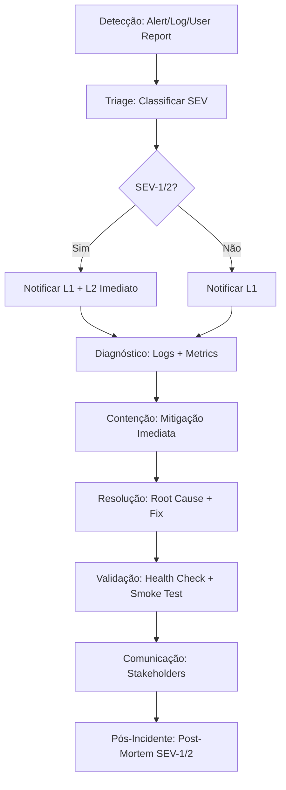

# Runbook — Resposta a Incidentes (COBECO MVP)

**Documento:** Runbook Operacional  
**Versão:** 1.0  
**Status:** Ativo  
**Data:** 27/10/2026  
**Autor:** Nicholas Anthony (DevOps / Tech Lead)  
**Aplica-se a:** prod | homolog  
**Classificação:** Interno

---

## 1. Propósito

Procedimento padronizado para detectar, diagnosticar, conter, resolver e documentar incidentes em produção/homologação.

---

## 2. Classificação de Severidade

| Nível | Definição | SLA Resposta | SLA Resolução | Escalação |
|-------|-----------|--------------|---------------|-----------|
| **SEV-1 (Crítico)** | Sistema indisponível, perda de dados, segurança | 15 min | 1 hora | Imediata (L1→L2→L3) |
| **SEV-2 (Alto)** | Funcionalidade principal quebrada, performance severa | 30 min | 4 horas | L1→L2 em 1h |
| **SEV-3 (Médio)** | Funcionalidade secundária, bug não-crítico | 2 horas | 1 dia útil | L1 |
| **SEV-4 (Baixo)** | Cosmético, documentação, melhoria | 1 dia útil | Próxima sprint | L1 |

---

## 3. Fluxo de Resposta



---

## 4. Procedimentos por Sintoma

### 4.1 Sistema Indisponível (SEV-1)

```bash
# 1. Verificar containers
docker ps --format "table {{.Names}}\t{{.Status}}\t{{.Ports}}"

# 2. Health checks
curl -sf https://cobeco.prod/v1/health
curl -sf https://cobeco.prod/

# 3. Logs recentes (últimos 100 linhas)
docker compose -f docker-compose.prod.yml logs --tail=100 backend
docker compose -f docker-compose.prod.yml logs --tail=100 proxy
docker compose -f docker-compose.prod.yml logs --tail=100 mysql

# 4. Reiniciar serviço afetado
docker compose -f docker-compose.prod.yml restart backend
# Aguardar health check
sleep 15
curl -sf https://cobeco.prod/v1/health
```

### 4.2 Erro 5xx no Backend (SEV-2)

```bash
# 1. Verificar logs de erro
docker compose -f docker-compose.prod.yml logs --tail=200 backend | grep -i "error\|exception\|traceback"

# 2. Verificar se é erro de DB
docker compose -f docker-compose.prod.yml logs --tail=100 mysql

# 3. Se erro de migration/schema
docker compose -f docker-compose.prod.yml exec backend alembic current
docker compose -f docker-compose.prod.yml exec backend alembic history

# 4. Rollback se deploy recente causou
# Ver RUNBOOK-DEPLOY.md seção Rollback
```

### 4.3 Banco de Dados Indisponível (SEV-1)

```bash
# 1. Verificar container MySQL
docker ps | grep mysql

# 2. Verificar logs
docker compose -f docker-compose.prod.yml logs --tail=100 mysql

# 3. Tentar reiniciar
docker compose -f docker-compose.prod.yml restart mysql

# 4. Se volume corrompido → Restore backup
# Ver RUNBOOK-BACKUP.md
```

### 4.4 Performance Degradada (SEV-2/3)

```bash
# 1. Verificar recursos
docker stats --no-stream

# 2. Verificar queries lentas (MySQL)
docker compose -f docker-compose.prod.yml exec mysql mysql -u root -proot -e "SHOW PROCESSLIST;"

# 3. Verificar cache hit rate (orcamento endpoint)
# Header X-Cache: HIT/MISS

# 4. Reiniciar backend se memory leak suspeito
docker compose -f docker-compose.prod.yml restart backend
```

---

## 5. Comunicação Durante Incidente

| Canal | Audiência | Frequência | Responsável |
|-------|-----------|------------|-------------|
| Discord `#cobeco-incidents` | Equipe técnica | Tempo real (SEV-1/2) | L1 |
| Email stakeholders | PO, Orientador | A cada 30min (SEV-1), 1h (SEV-2) | PO |
| GitHub Issue | Rastreabilidade | Criação + atualizações | L1 |

**Template de Atualização:**
```
[SEV-X] Incidente: <título>
Status: Investigando / Mitigando / Resolvido / Monitorando
Impacto: <usuários afetados, funcionalidades>
Ações: <o que foi feito>
Próximos passos: <o que vem a seguir>
ETA resolução: <tempo estimado>
```

---

## 6. Pós-Incidente (Obrigatório para SEV-1/2)

| Item | Prazo | Responsável |
|------|-------|-------------|
| Post-Mortem Blameless | 48h | Tech Lead |
| 5 Porquês (Root Cause) | No Post-Mortem | Equipe |
| Ações Corretivas | No Post-Mortem | Dono da ação |
| Ações Preventivas | No Post-Mortem | Dono da ação |
| Atualização Runbooks | 1 semana | DevOps |
| Atualização Docs/Alerts | 1 semana | DevOps |

**Template Post-Mortem:** `docs/auditorias/POST-MORTEM.md`

---

## 7. Contatos de Escalação

| Nível | Papel | Nome | Contato | SLA |
|-------|-------|------|---------|-----|
| L1 | Dev de Plantão | Nicholas Anthony | Discord @nathony + Phone | Imediato |
| L2 | Tech Lead | Leonardo Setti | Discord @leosetti + Phone | 15 min |
| L3 | CCB Chair / PO | Leonardo Setti | Discord @leosetti + Phone | 30 min |
| L4 | Orientador | [Nome] | Email institucional | 1h |

---

## 8. Checklist de Prontidão (Validar Mensalmente)

- [ ] Alertas configurados (GitHub Actions, uptime, error rate)
- [ ] Runbooks acessíveis e atualizados
- [ ] Contatos de escalação válidos
- [ ] Backups testados (restore simulado)
- [ ] Game Day realizado (simulação incidente)
- [ ] Post-Mortems anteriores revisados

---

## Controle de Versões

| Versão | Data | Autor | Mudança |
|--------|------|-------|---------|
| 1.0 | 27/10/2026 | Nicholas Anthony | Criação inicial |

---

**Fim do Runbook — Incident Response**  
*Revisar a cada Sprint Review. Game Day a cada 2 sprints.*