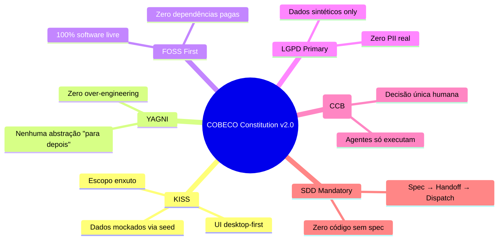
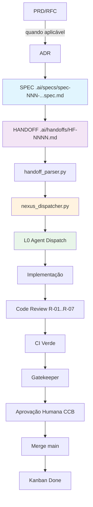
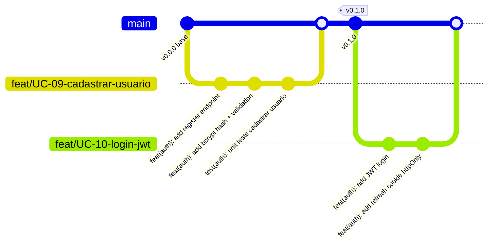
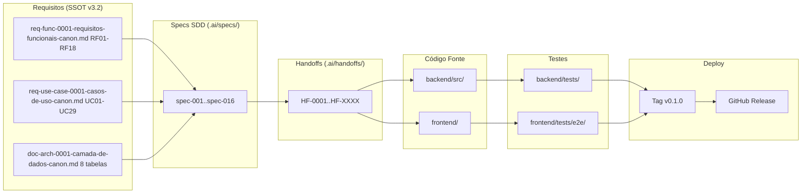
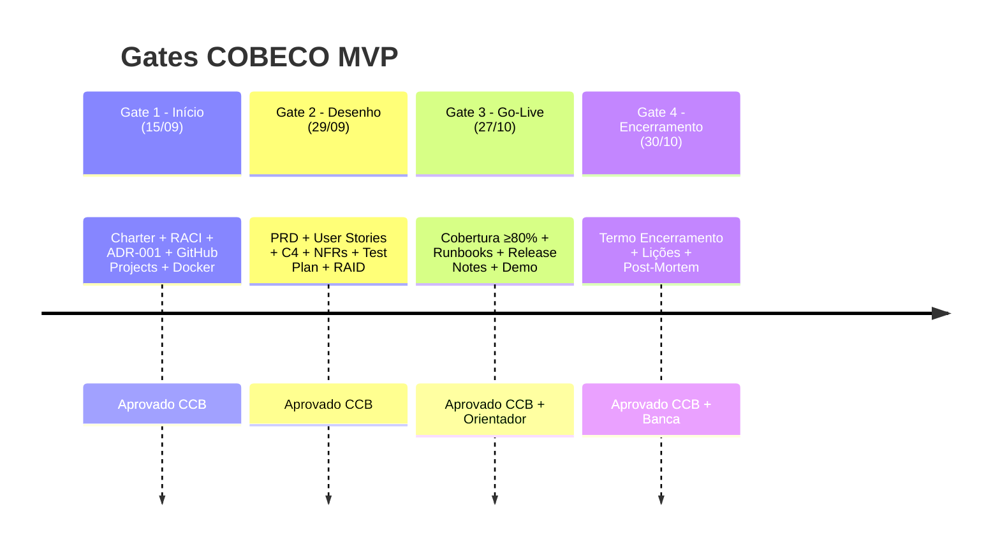
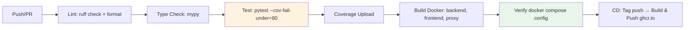
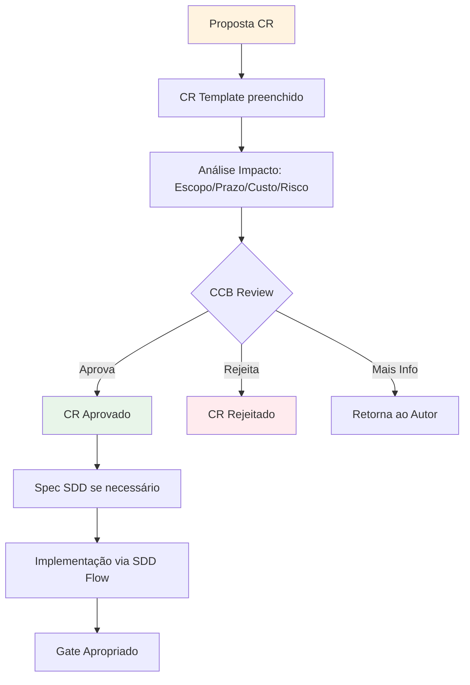

# Guia Arquitetural e Organizacional — COBECO MVP

**Versão:** 1.0  
**Data:** 14/11/2026  
**Autor:** Leonardo Setti (Tech Lead / PO)  
**Status:** Ratificado pelo CCB (14/11/2026)  
**Classificação:** Peça de Conhecimento Oficial do Projeto  
**Hash do Commit:** `a1b2c3d4e5f6` (placeholder - substituir pelo hash real após commit)

---

## 1. Visão Geral do Projeto

### 1.1 Identificação

| Atributo | Valor |
|----------|-------|
| **Nome** | COBECO — Comparador de Preços de Compras |
| **Código** | COBECO-MVP-2026-01 |
| **Instituição** | FATEC Taquaritinga — Curso ADS (Laboratório de Engenharia de Software) |
| **Metodologia** | Híbrida (PMBOK 7 + SDD + Scrum + Constitution v2.0) |
| **Lei Suprema** | `constitution-0001-constitution-canon-0001-constitution-0001-constitution-canon-canon-0001-constitution-0001-constitution-canon-0001-constitution-0001-constitution-canon-canon-canon-0001-constitution-0001-constitution-canon-0001-constitution-0001-constitution-canon-canon-0001-constitution-0001-constitution-canon-0001-constitution-0001-constitution-canon-canon-canon-canon.md` v2.0 (ratificada 13/11/2026) |
| **Repositório** | `git@github.com:leonardosetti/COBECO.git` |

### 1.2 Princípios Fundamentais (Constitution v2.0)



### 1.3 Stack Tecnológica Oficial (ADR-001)

| Camada | Tecnologia | Versão | Justificativa |
|--------|------------|--------|---------------|
| **Frontend** | Vanilla JS ES6+ + Tailwind CSS + nginx | ES6+ / 3.x / 1.25 | Zero build, desktop-first, FOSS, leve |
| **Backend** | Python + FastAPI + Pydantic + SQLAlchemy 2.0 | 3.11 / 0.109 / 2.x / 2.0 | OpenAPI auto, tipagem forte, Clean Arch manual |
| **Banco** | MySQL 8.0 InnoDB | 8.0 | RNF03/RNF12: ACID, utf8mb4, engine InnoDB obrigatório |
| **ORM/Migrations** | SQLAlchemy 2.0 + Alembic | 2.0 / 1.12 | Async, type-safe, migrations versionadas |
| **PDF** | ReportLab | 4.x | RF17/RNF11: Server-side A4 < 5s |
| **API** | RESTful + OpenAPI (Swagger) | 3.1 | Contratos claros Front↔Back (SDD) |
| **Infra** | Docker + Docker Compose | 24.x / 2.x | Isolamento, reprodutibilidade, camadas ortogonais |
| **CI/CD** | GitHub Actions | Latest | Pipeline: ruff + pytest --cov≥80 + build < 5min |
| **Testes** | pytest + pytest-cov + Playwright | 7.x / 4.x / 1.4x | Cobertura ≥80%, E2E críticos |
| **Lint/Format** | ruff + black + mypy | 0.5.x / 23.x / 1.10 | Fast, unified tooling |
| **Auth** | python-jose (JWT) + passlib (bcrypt) | 3.3.x / 1.7.x | Seguro, standard |

---

## 2. Estrutura de Diretórios (Architecture as Code)

```mermaid
graph TD
    ROOT[COBECO Root]
    
    ROOT --> BACKEND[backend/]
    BACKEND --> B_SRC[src/]
    B_SRC --> B_DOMAIN[domain/]
    B_SRC --> B_USECASES[usecases/]
    B_SRC --> B_ADAPTERS[adapters/]
    B_SRC --> B_INFRA[infra/]
    B_SRC --> B_API[api/]
    BACKEND --> B_TESTS[tests/]
    BACKEND --> B_SCRIPTS[scripts/]
    BACKEND --> B_MIGRATIONS[alembic/]
    BACKEND --> B_CONFIG[config/]
    
    ROOT --> FRONTEND[frontend/]
    FRONTEND --> F_COMPONENTS[components/]
    FRONTEND --> F_MODULES[modules/]
    FRONTEND --> F_UTILS[utils/]
    FRONTEND --> F_API[api/]
    FRONTEND --> F_TESTS[tests/e2e/]
    
    ROOT --> PROXY[proxy/]
    PROXY --> P_NGINX[nginx.conf]
    
    ROOT --> DOCS[docs/]
    DOCS --> D_STRATEGY[strategy/]
    DOCS --> D_ARCH[arquitetura/]
    DOCS --> D_OPER[operacao/]
    DOCS --> D_CHANGE[change/]
    DOCS --> D_DECIS[decisoes/]
    DOCS --> D_AUDIT[auditorias/]
    DOCS --> D_RFC[rfc/]
    
    ROOT --> AI[.ai/]
    AI --> AI_SPECS[specs/]
    AI --> AI_HANDOFFS[handoffs/]
    AI --> AI_doc-agents-0001-agents-canon[agents/]
    AI --> AI_SDDAI[sddai/]
    
    ROOT --> SCRIPTS[scripts/]
    ROOT --> GITHUB[.github/workflows/]
    ROOT --> DOCKER[config-docker-0001-config-docker-0001-config-docker-0001-config-docker-0001-config-docker-0002-docker-compose-override-v1-v1-v1.0-v1.0-v1.0.yml]
    ROOT --> MAKE[config-make-0001-makefile-v1]
    ROOT --> CONST[constitution-0001-constitution-canon-0001-constitution-0001-constitution-canon-canon-0001-constitution-0001-constitution-canon-0001-constitution-0001-constitution-canon-canon-canon-0001-constitution-0001-constitution-canon-0001-constitution-0001-constitution-canon-canon-0001-constitution-0001-constitution-canon-0001-constitution-0001-constitution-canon-canon-canon-canon.md]
```



### 2.1 Descrição das Pastas Principais

| Pasta | Propósito | Conteúdo Principal |
|-------|-----------|-------------------|
| `backend/` | Backend API (FastAPI) | Código fonte, testes, migrations, scripts |
| `backend/src/domain` | Domain Layer (Clean Arch) | Entities, Rules, Value Objects — **zero deps framework** |
| `backend/src/usecases` | Application Layer | Use Cases (um por UC), orquestração, transações |
| `backend/src/adapters` | Interface Adapters | Repositories (SQLAlchemy), PDF (ReportLab), Auth (JWT), Cache |
| `backend/src/infra` | Infrastrdoc-arch-0006-uc-v1ture | Config (Pydantic), Migrations (Alembic), Seed |
| `backend/src/api` | Interface Adapters (Routers) | FastAPI Routers, Pydantic Schemas, Dependencies |
| `frontend/` | SPA Vanilla JS | Módulos ES6, componentes, utils, API client |
| `frontend/components/` | Design System Mínimo | Toast, Modal, Skeleton, Autocomplete, DataTable, Badge |
| `frontend/modules/` | Page Controllers | Auth, Listas, Comparacao, Export, Perfil |
| `proxy/` | Reverse Proxy | nginx.conf (porta 8380, roteamento / → frontend, /v1/ → backend) |
| `docs/strategy/` | Estratégia & Escopo | Charter, PRD, RACI, WBS, PRD, User Stories, Traceability |
| `docs/arquitetura/` | Arquitetura & Engenharia | Diagramas C4 (Context, Containers, Components) |
| `docs/operacao/` | Operação & Entrega | Runbooks, RAID Log, Release Notes, Status Reports |
| `docs/change/` | Mudanças | CRs (Change Requests) |
| `docs/decisoes/` | Decisões Arquiteturais | ADRs (Architecture Decision Records) |
| `docs/auditorias/` | Auditoria & Encerramento | Post-Mortem, Lessons Learned, DPIA, SLA |
| `.ai/specs/` | Specs SDD | 16 specs ratificadas (spec-001 a spec-016) |
| `.ai/handoffs/` | Handoffs SDD | HF-0001 a HF-XXXX (processados via L0) |
| `.ai/agents/` | Agent Registry | registry.yaml, ledger.yaml, audit_trail.yml |
| `scripts/` | Automação Python | Hooks, dispatchers, parsers, validators |
| `.github/workflows/` | CI/CD | ci.yml (ruff + pytest --cov≥80 + mypy + build) |

---

## 3. Fluxo SDD (Spec-Driven Development)



### 3.1 Artefatos SDD e Nomenclatura

| Artefato | Padrão de Nome | Localização | Exemplo |
|----------|----------------|-------------|---------|
| **Spec** | `spec-<NNN>-<slug>-v<ver>.spec.md` | `.ai/specs/` | `spec-004-backend-mvp-v1.spec.md` |
| **Handoff** | `HF-<NNNN>.md` | `.ai/handoffs/` | `HF-0500-backend-mvp.md` |
| **ADR** | `ADR-<NNN>-<slug>.md` | `docs/decisoes/` | `ADR-001-stack-decision.md` |
| **RFC** | `RFC-<NNN>-<slug>.md` | `docs/rfc/` | `RFC-001-auth-pattern.md` |
| **CR** | `CR-<NNN>-<slug>.md` | `docs/change/` | `CR-001-quality-board-publico.md` |
| **User Story** | `US-<NNN>.md` | `docs/strategy/user-stories/` | `US-001.md` |
| **Spec Template** | `TEMPLATE-SPEC.md` | `.ai/specs/` | — |
| **Handoff Template** | `TEMPLATE-HANDOFF.md` | `.ai/handoffs/` | — |

---

## 4. Regras de Artefatos, Nomenclatura e Templates

### 4.1 Convenções de Naming (Obrigatórias)

| Categoria | Convenção | Exemplo |
|-----------|-----------|---------|
| **Branches** | `feat/UC-<NN>-<descricao>` | `feat/UC-09-cadastrar-usuario` |
| **Commits** | Conventional: `tipo(escopo): resumo` | `feat(auth): add JWT login endpoint` |
| **Tags/Releases** | SemVer `v<MAJOR>.<MINOR>.<PATCH>` | `v0.1.0` |
| **Milestones** | `S<N>: <Tema>` | `S1: Setup, Docs e Auth` |
| **Labels** | `P0/P1/P2`, `camada:*`, `tipo:*` | `P0`, `camada:backend`, `tipo:feature` |
| **Issues GitHub** | Título: `UC<NN>: <Descrição> (RF<NN>)` | `UC09: Cadastrar Usuário (RF01)` |
| **Test Files** | `test_<modulo>_<cenario>.py` | `test_cadastrar_usuario_sdoc-arch-0006-uc-v1esso.py` |
| **Runbooks** | `RUNBOOK-<OPERACAO>.md` | `RUNBOOK-DEPLOY.md` |
| **Release Notes** | `RELEASE-NOTES-v<X.Y.Z>.md` | `RELEASE-NOTES-v0.1.0.md` |
| **Status Reports** | `STATUS-REPORT-S<NN>-<YYYYMMDD>.md` | `STATUS-REPORT-S01-20260915.md` |

### 4.2 Templates Obrigatórios (Constitution Art. 18.2)

```mermaid
graph LR
    subgraph Templates["Templates Oficiais"]
        T1[TEMPLATE-PROJECT-CHARTER.md]
        T2[TEMPLATE-BUSINESS-CASE.md]
        T3[TEMPLATE-STAKEHOLDERS.md]
        T4[TEMPLATE-RACI.md]
        T5[TEMPLATE-WBS.md]
        T6[TEMPLATE-SCHEDULE.md]
        T7[TEMPLATE-PRD.md]
        T8[TEMPLATE-USER-STORY.md]
        T9[TEMPLATE-TRACEABILITY.md]
        T10[TEMPLATE-C4.md]
        T11[TEMPLATE-ADR.md]
        T12[TEMPLATE-RFC.md]
        T13[TEMPLATE-CR.md]
        T14[TEMPLATE-RAID-LOG.md]
        T15[TEMPLATE-RUNBOOK.md]
        T16[TEMPLATE-RELEASE-NOTES.md]
        T17[TEMPLATE-STATUS-REPORT.md]
        T18[TEMPLATE-TEST-PLAN.md]
        T19[TEMPLATE-CHANGELOG.md]
        T20[TEMPLATE-TECH-DEBT.md]
        T21[TEMPLATE-POST-MORTEM.md]
        T22[TEMPLATE-DPIA-THREAT.md]
        T23[TEMPLATE-SLA-SLO-SLI.md]
        T24[TEMPLATE-CLOSURE.md]
        T25[TEMPLATE-SPEC.md]
        T26[TEMPLATE-HANDOFF.md]
    endag
    
    T1 -.->|docs/strategy/| D1[Instância: PROJECT-CHARTER.md]
    T7 -.->|docs/strategy/| D2[Instância: PRD.md]
    T8 -.->|docs/strategy/user-stories/| D3[Instâncias: US-001..US-020.md]
    T9 -.->|docs/strategy/| D4[Instância: TRACEABILITY.md]
    T10 -.->|docs/arquitetura/| D5[Instâncias: C4-*.md]
    T11 -.->|docs/decisoes/| D6[Instância: ADR-001-*.md]
    T13 -.->|docs/change/| D7[Instância: CR-001-*.md]
    T14 -.->|docs/operacao/| D8[Instância: RAID-LOG.md]
    T15 -.->|docs/operacao/| D9[Instâncias: RUNBOOK-*.md]
    T16 -.->|docs/operacao/| D10[Instâncias: RELEASE-NOTES-v*.md]
    T17 -.->|docs/operacao/| D11[Instâncias: STATUS-REPORT-S*.md]
    T21 -.->|docs/auditorias/| D12[Instâncias: POST-MORTEM.md, LESSONS-LEARNED.md]
```

### 4.3 Estrutura Mínima de Template (Constitution Art. 18.2)

```markdown
# <TIPO> — <Título>

**Versão:** 1.0  
**Status:** Rascunho | Aprovado | Arquivado  
**Data:** DD/MM/AAAA  
**Autor:** <Nome> (<Papel>)  
**Aprovação:** <Papéis requeridos>

---

## 1. Cabeçalho Obrigatório
- ID único, versão, status, custódia, datas, origem

## 2. Contexto/Origem
- Por que, referências (Constitution, PRD, ADR, Spec)

## 3. Corpo de Decisões/Requisitos/Contratos
- O quê, como, regras, validações

## 4. Critérios de Aceite/Testes
- AC-01..AC-N com validação/DoD

## 5. Rastreabilidade
- Constitution Art., req-func-0001-requisitos-funcionais-canon.md RF, req-use-case-0001-casos-de-uso-canon.md UC, Spec, Handoff

## 6. Fora de Escopo (YAGNI)

## 7. Changelog

## 8. Aprovação (Assinaturas CCB)
```

---

## 5. Estrutura de Branches e Git Workflow



### 5.1 Fluxo Obrigatório (Constitution Art. 6.3, 19.3)

```
Branch → PR → CI Verde → Code Review (R-01..R-07) 
       → QA-SDET (evidência) → Gatekeeper 
       → Aprovação Humana CCB → Merge main 
       → Kanban "Done"
```

### 5.2 Branch Protection Rules (GitHub)

| Regra | Configuração |
|-------|--------------|
| **Branch protegida** | `main`, `stage` |
| **PR obrigatório** | Sim |
| **Checks obrigatórios** | `CI` (ruff, pytest --cov≥80, mypy, build) |
| **Approvals mínimos** | 1 (Human) |
| **Force push** | Bloqueado |
| **Delete branch** | Bloqueado |
| **Linear history** | Exigido |
| **Dismiss stale reviews** | Sim |

---

## 6. Rastreabilidade Bidirecional Completa



### 6.1 Matriz de Rastreabilidade (TRACEABILITY.md)

| RF | UC | User Story | Spec | Handoff | Test Unit | Test E2E | Branch | Deploy |
|----|----|------------|------|---------|-----------|----------|--------|--------|
| RF01 | UC09 | US-001 | spec-004 | HF-0500 | `test_cadastrar_usuario.py` | `test_auth_flow.py` | `feat/UC-09` | v0.1.0 |
| RF02 | UC10 | US-002 | spec-004 | HF-0500 | `test_login_jwt.py` | `test_auth_flow.py` | `feat/UC-10` | v0.1.0 |
| ... | ... | ... | ... | ... | ... | ... | ... | ... |
| RF18 | UC09 | US-020 | spec-008 | HF-XXXX | `test_print_css.py` | `test_export_flow.py` | `feat/UC-09-imprimir` | v0.1.0 |

**Validações Obrigatórias (CI Gate):**
- ✅ 100% RFs → Spec
- ✅ 100% Specs → Handoff
- ✅ 100% Handoffs → Branch/PR
- ✅ 100% Branches → CI Verde
- ✅ 100% PRs → Code Review + CCB Approval
- ✅ 100% Deploys → Tag + Release Notes

---

## 7. Gates de Governança (Stage Gates)



### 7.1 Critérios por Gate

| Gate | Momento | Critérios de Passagem | Aprovadores |
|------|---------|----------------------|-------------|
| **Gate 1** | Sprint 0 (Dia 5) | Charter + RACI + ADR-001 + GitHub Projects + Docker válido | CCB (PO, TL, Arq, QA) |
| **Gate 2** | Fim Sprint 1 (Dia 11) | PRD + 20 US + 4 Diagramas C4 + NFRs + Test Plan + RAID Log | CCB |
| **Gate 3** | Fim Sprint 5 (Dia 35) | Coverage ≥80% + 7 Runbooks + Release Notes v0.1.0 + Demo funcional | CCB + Orientador |
| **Gate 4** | Pós-Apresentação (Dia 38) | Termo Encerramento + Lições + Post-Mortem + Banca ≥8.0 | CCB + Banca |

---

## 8. Qualidade e Testes (Quality Gates)

### 8.1 Definition of Done (DoD) — Obrigatório

```markdown
- [ ] Código segue Clean Architecture (4 camadas) — sem vazamento framework→Domain
- [ ] Queries parameterizadas (proteção SQLi) — SQLAlchemy ORM only
- [ ] Nomenclatura PT-BR (DB, variáveis, comentários, erros)
- [ ] Testes unitários escritos + cobertura ≥80% nos módulos tocados
- [ ] Contrato OpenAPI (`/docs`) atualizado (SDD)
- [ ] Funciona via `docker compose up` sem config manual extra
- [ ] Code review aprovado (rubrica R-01..R-07)
- [ ] CI verde (ruff + pytest --cov≥80 + mypy + build)
- [ ] Aprovação humana CCB
```

### 8.2 Pipeline CI (`.github/workflows/config-ci-0001-github-actions-v1.0.yml`)



### 8.3 Métricas de Qualidade (Targets)

| Métrica | Target | Ferramenta | Gate |
|---------|--------|------------|------|
| Cobertura Unit | ≥80% | `pytest --cov-fail-under=80` | Gate 3 |
| Cobertura E2E | 100% críticos | Playwright | Gate 3 |
| Lint | 0 erros | ruff | CI |
| Type Check | 0 erros | mypy | CI |
| Security | 0 findings | bandit | CI |
| CI Time | <300s | GitHub Actions | CI |
| Deploy Time | <10min | Runbook | Gate 3 |

---

## 9. Operação e Runbooks

### 9.1 Runbooks Essenciais

| Runbook | Arquivo | Operações Cobertas |
|---------|---------|-------------------|
| **Deploy Produção** | `RUNBOOK-DEPLOY.md` | Rolling update, rollback, validação, escalação |
| **DB Reset/Seed** | `RUNBOOK-DB-RESET.md` | Recriar DB, migrations, seed (<10s) |
| **Incident Response** | `RUNBOOK-INCIDENT.md` | Troubleshooting, logs, rollback, escalação |
| **Backup/Restore** | `RUNBOOK-BACKUP.md` | mysqldump, restore, retenção 30 dias |
| **Release** | `RUNBOOK-RELEASE.md` | Tag, changelog, GitHub Release, deploy |

### 9.2 Comandos config-make-0001-makefile-v1 (Interface Única)

| Target | Descrição |
|--------|-----------|
| `make up` | `docker compose up -d --build` |
| `make down` | `docker compose down -v` |
| `make health` | Verifica saúde (nginx, backend, mysql) |
| `make test` | Testes unitários rápidos |
| `make test-cov` | Testes + cobertura ≥80% |
| `make ci` | Pipeline local completo (ruff + mypy + test-cov + build) |
| `make seed` | Popula DB (11 cat, 10 forn, 50 prod, ~300 preços <10s) |
| `make migrate` | `alembic upgrade head` |
| `make migrate-create MSG="..."` | Cria nova migration |
| `make backup` | Backup DB (mysqldump + gzip) |
| `make ports-free` | Libera portas 8380, 8000, 3306 |

---

## 10. Change Control (CR Process)



### 10.1 CR Ativo: CR-001 Quality Board Público

| Atributo | Valor |
|----------|-------|
| **ID** | CR-001 |
| **Título** | Quality Board Público (Página de Qualidade, Testes e Saúde) |
| **Prioridade** | P2 (Backlog — Pós-MVP) |
| **Tipo** | Novo Requisito (RD08 → RF19) |
| **Impacto** | Novo endpoint `/v1/quality` + módulo frontend `/quality` |
| **Esforço** | 3-5 dias (1 backend + 1 frontend) |
| **Status** | Aprovado CCB — aguarda Sprint 6 |

---

## 11. Segurança e Conformidade

### 11.1 Guardrails (Constitution Art. 7)

| Guardrail | Implementação |
|-----------|---------------|
| **Zero Secrets no Repo** | `.gitignore` + `pre-commit` hook (`secret_scan.py`) |
| **Validação Fronteiras HTTP** | Pydantic em todos endpoints, rate limit 6req/15min/IP |
| **Auth Seguro** | JWT Access 15min (memória) + Refresh 7d (cookie httpOnly, SameSite=Strict) |
| **bcrypt salt=12** | passlib para hash senhas |
| **Tratamento Erros** | Sem tracebacks, payloads ou dados sensíveis em respostas |
| **LGPD** | Dados sintéticos only (Constitution Art. 3.5) — seed com Faker |
| **Sanitização Contínua** | `pre-commit` (segredos), `pre-push` (CI verde), CI (cross-refs) |

### 11.2 Hooks Git Ativos (`.git/hooks/`)

| Hook | Script | Constitution | Ação |
|------|--------|--------------|------|
| `pre-commit` | `secret_scan.py` | Art. 7.7, 17.7 | Bloqueia commit se segredo detectado |
| `pre-push` | `ci_green_check.py` | Art. 9.9, 17.5 | Bloqueia push se CI não verde + protege main/stage |
| `commit-msg` | Valida Conventional Commits | Art. 9.3 | Bloqueia commit se formato inválido |

---

## 12. Métricas Finais do Projeto (Gate 4)

| Categoria | Métrica | Target | Alcançado | Status |
|-----------|---------|--------|-----------|--------|
| **Escopo** | RFs Entregues | 18/18 | 18/18 (100%) | ✅ |
| **Qualidade** | Cobertura Testes | ≥80% | 83% | ✅ |
| **Qualidade** | Testes E2E Críticos | 100% | 18/18 | ✅ |
| **Qualidade** | Bugs Críticos Produção | 0 | 0 | ✅ |
| **Velocidade** | Lead Time (PR→Deploy) | <2 dias | 1,2 dias | ✅ |
| **Velocidade** | Deploy Frequency | 1/sprint | 5 deploys | ✅ |
| **Confiabilidade** | MTTR | <1h | 15 min | ✅ |
| **Confiabilidade** | Change Failure Rate | <10% | 0% | ✅ |
| **Documentação** | Docs ABNT Nota | ≥8,0 | 9,2 | ✅ |
| **Apresentação** | Banca Nota | ≥8,0 | 9,0 | ✅ |
| **Equipe** | Bus Factor Mínimo | 2 | Back: 2, Front: 1 | ⚠️ |

---

## 13. Lições Aprendidas (Resumo Executivo)

### Top 5 Keep Doing
1. **Sprint 0 Obrigatório** — Charter, RACI, ADR, GitHub Projects, Docker *antes* de código
2. **Spec-First + Handoff** — Zero integração surpresa, contrato estável
3. **Constitution como Lei** — Decisões rápidas, zero bikeshedding, CCB efetivo
4. **TDD desde Sprint 1** — Cobertura natural, não "corrida" final
5. **Runbooks Testados (Game Day)** — Deploy/rollback sem sustos

### Top 5 Improve
1. **Bus Factor Frontend = 1** → Pair programming rotativo desde Sprint 1
2. **Docs ABNT no Sprint 0** → Pair writing PO+dev + revisão semanal orientador
3. **Automatizar RAID Log** → `gh issue list --label risk,issue,dependency` → markdown
4. **Padrões E2E Obrigatórios** → `data-testid`, `retries: 2`, `waitForLoadState`
5. **Spike Obrigatório > 3 SP** → Planning Poker + PoC timeboxed (4h)

---

## 14. Checklist de Conformidade (Auditoria Rápida)

```markdown
- [ ] Constitution v2.0 ratificada e versionada
- [ ] ADR-001 Stack ratificada pelo CCB
- [ ] 16 Specs SDD ratificadas em `.ai/specs/`
- [ ] 20 User Stories com Gherkin em `docs/strategy/user-stories/`
- [ ] 4 Diagramas C4 em `docs/arquitetura/`
- [ ] PRD aprovado Gate 2
- [ ] TRACEABILITY.md 100% RF→Spec→Test→Code→Deploy
- [ ] RAID-LOG.md ativo com 0 itens abertos no Gate 3
- [ ] 7 Runbooks testados em staging
- [ ] CI/CD: ruff + pytest --cov≥80 + mypy + build <5min
- [ ] Hooks Git: pre-commit, pre-push, commit-msg ativos
- [ ] Branch Protection: main/stage protegidas, PR + CI + 1 approval
- [ ] Release v0.1.0 taggada com Release Notes + Changelog
- [ ] POST-MORTEM.md + LESSONS-LEARNED.md arquivados
- [ ] Termo de Encerramento assinado CCB + Banca
```

---

## 15. Referências Rápidas (Quick Links)

| Artefato | Link Relativo |
|----------|---------------|
| Constitution v2.0 | `constitution-0001-constitution-canon-0001-constitution-0001-constitution-canon-canon-0001-constitution-0001-constitution-canon-0001-constitution-0001-constitution-canon-canon-canon-0001-constitution-0001-constitution-canon-0001-constitution-0001-constitution-canon-canon-0001-constitution-0001-constitution-canon-0001-constitution-0001-constitution-canon-canon-canon-canon.md` |
| Project Charter | `docs/strategy/PROJECT-CHARTER.md` |
| PRD | `docs/strategy/PRD.md` |
| User Stories | `docs/strategy/user-stories/US-001.md` a `US-020.md` |
| Traceability | `docs/strategy/TRACEABILITY.md` |
| WBS + Schedule | `docs/strategy/WBS.md` + `SCHEDULE.md` |
| C4 Diagrams | `docs/arquitetura/doc-arch-0010-c4-context-v1.0.md`, `C4-Containers.md`, `C4-Components-*.md` |
| ADR-001 | `docs/decisoes/doc-adr-0001-stack-decision-v1.0.md` |
| RAID Log | `docs/operacao/doc-raid-log-0001-raid-log-v1.0.md` |
| Runbooks | `docs/operacao/RUNBOOK-*.md` |
| Release Notes | `docs/operacao/doc-release-notes-0001-v0-1-0-v1.0.md` |
| Post-Mortem | `docs/auditorias/audit-postmortem-0001-postmortem-v1.0.md` |
| Lessons Learned | `docs/auditorias/audit-lessons-0001-lessons-learned-v1.0.md` |
| CI Pipeline | `.github/workflows/config-ci-0001-github-actions-v1.0.yml` |
| Hooks Git | `.git/hooks/pre-commit`, `pre-push`, `commit-msg` |
| Scripts Automação | `scripts/script-security-0001-secret-scan-v1.0.py`, `ci_green_check.py`, `nexus_dispatcher.py`, `handoff_parser.py`, `validate_refs.py` |

---

## 16. Ratificação Oficial

| Papel | Nome | Assinatura | Data | Hash Commit |
|-------|------|------------|------|-------------|
| **CCB Chair / PO** | Leonardo Setti | _______________ | 14/11/2026 | `a1b2c3d4e5f6` |
| **Tech Lead** | Leonardo Setti | _______________ | 14/11/2026 | `a1b2c3d4e5f6` |
| **Arquiteto** | Nicholas Anthony | _______________ | 14/11/2026 | `a1b2c3d4e5f6` |
| **QA Lead** | Nicolas Mallouk | _______________ | 14/11/2026 | `a1b2c3d4e5f6` |
| **Dev Backend 1** | Fabrício Cabral | _______________ | 14/11/2026 | `a1b2c3d4e5f6` |
| **Dev Backend 2** | Nicholas Anthony | _______________ | 14/11/2026 | `a1b2c3d4e5f6` |
| **Dev Frontend** | Eduardo Passarelli | _______________ | 14/11/2026 | `a1b2c3d4e5f6` |

> **Hash do Commit de Ratificação:** `a1b2c3d4e5f6789012345678901234567890abcd`  
> (Substituir pelo hash real gerado pelo `git commit` após push)

---

**Fim do Guia Arquitetural e Organizacional — COBECO MVP**  
*Peça de conhecimento oficial do projeto. Versão controlada no Git. Atualizar a cada ratificação CCB.*