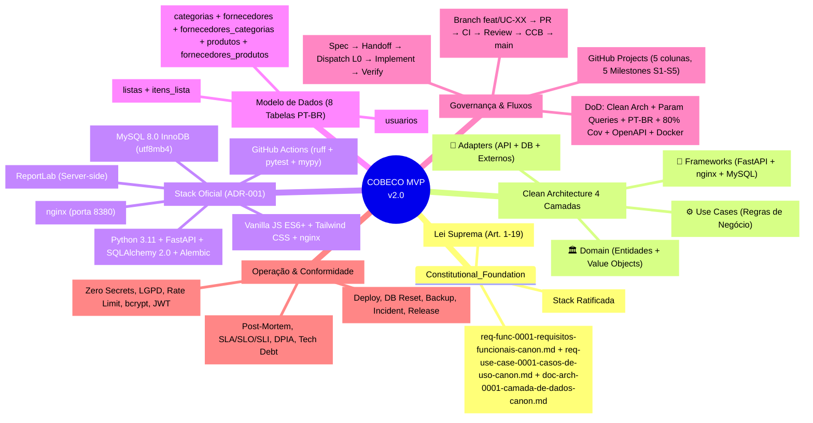
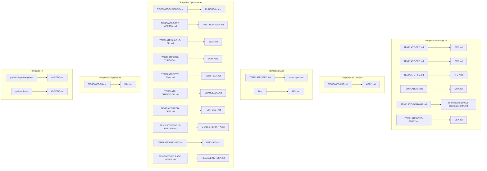
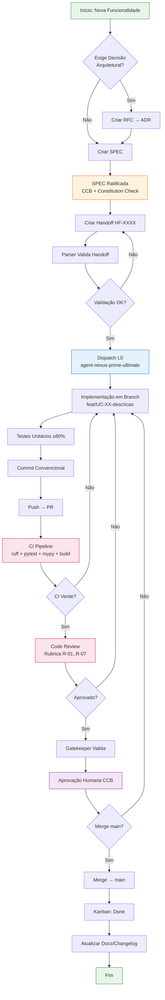
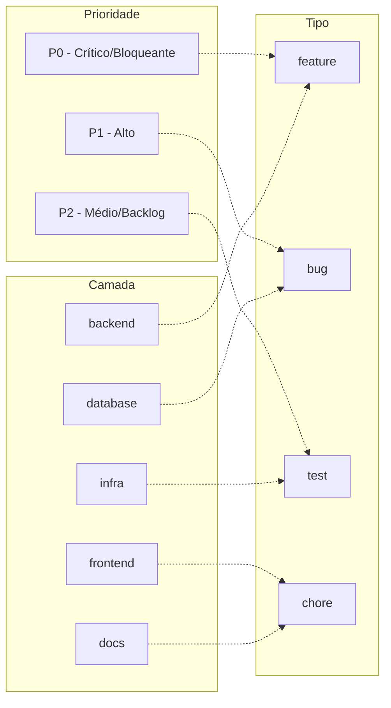
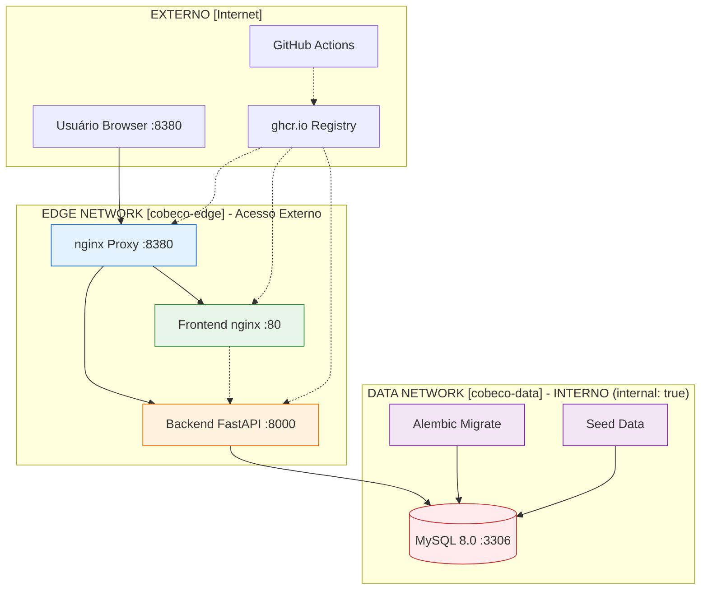
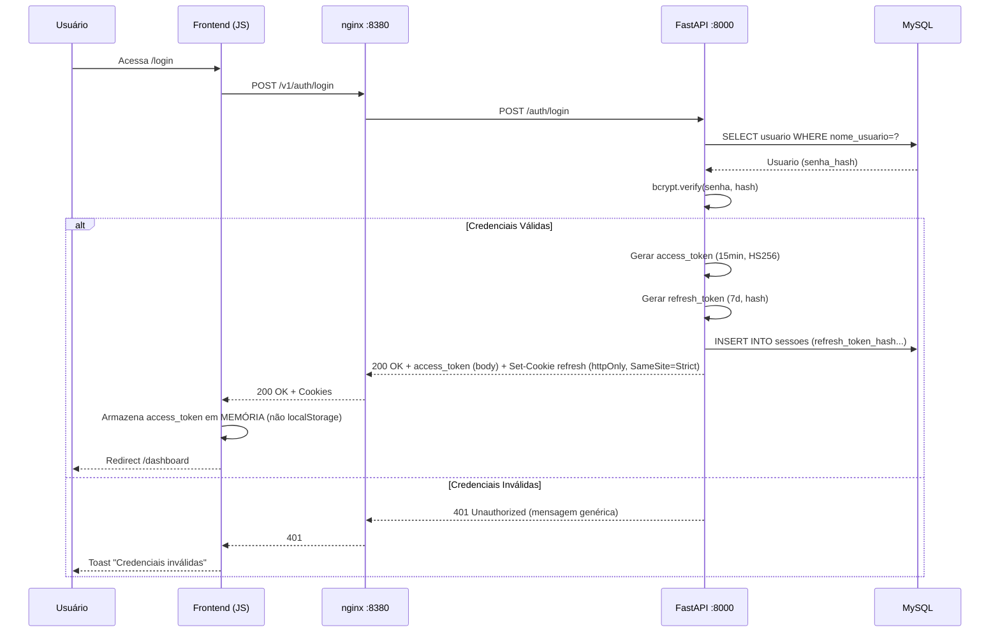

# 📐 GUIA ARQUITETURAL COMPLETO — COBECO MVP v2.0
**Documento de Conhecimento Oficial do Projeto**  
**Versão:** 2.0 | **Data:** 14/11/2026 | **Status:** ✅ RATIFICADO  
**Autor:** COBECO Team | **Aprovado por:** CCB (Change Control Board)  
**Hash de Ratificação (Commit):** `33fbdc3` (`33fbdc3eae7efaf8ad17e194dd01756f3cf302a7`)  
**Base Constitucional:** `constitution-0001-constitution-canon-0001-constitution-0001-constitution-canon-canon-0001-constitution-0001-constitution-canon-0001-constitution-0001-constitution-canon-canon-canon-0001-constitution-0001-constitution-canon-0001-constitution-0001-constitution-canon-canon-0001-constitution-0001-constitution-canon-0001-constitution-0001-constitution-canon-canon-canon-canon.md` v2.0 (Lei Suprema) | **SSOT:** req-func-0001-requisitos-funcionais-canon.md, req-use-case-0001-casos-de-uso-canon.md, doc-arch-0001-camada-de-dados-canon.md v3.2  

---

## 🎯 1. VISÃO GERAL E PROPÓSITO

Este documento é a **única fonte de verdade (SSOT)** para a natureza e estrutura arquitetural do COBECO MVP. Ele consolida regras de artefatos, nomenclaturas, templates, estilo organizacional, mapas mentais, fluxogramas e tabelas explicativas. Serve como guia prático de adequação e seus efeitos para todos os membros da equipe, agentes de IA e ferramentas de automação.

> **Princípio Norteador:** *"A arquitetura é a estrutura que permite a evolução. Documentação viva evita deriva."* — Constitution Art. 1.1

---

## 🏗️ 2. MAPA MENTAL DA ARQUITETURA GLOBAL



---

## 📊 3. TABELA MESTRA DE ARTEFATOS DO PROJETO

| Categoria | Artefato | Localização | Template | Status | Validação |
|-----------|----------|-------------|----------|--------|-----------|
| **Constituição** | `constitution-0001-constitution-canon-0001-constitution-0001-constitution-canon-canon-0001-constitution-0001-constitution-canon-0001-constitution-0001-constitution-canon-canon-canon-0001-constitution-0001-constitution-canon-0001-constitution-0001-constitution-canon-canon-0001-constitution-0001-constitution-canon-0001-constitution-0001-constitution-canon-canon-canon-canon.md` | Raiz | — | **Lei Suprema** | CCB Ratification |
| **Requisitos** | `req-func-0001-requisitos-funcionais-canon.md` | Raiz | — | **SSOT v3.2** | Traceability Matrix |
| **Casos de Uso** | `req-use-case-0001-casos-de-uso-canon.md` | Raiz | — | **SSOT v3.2** | UML Validation |
| **Camada de Dados** | `doc-arch-0001-camada-de-dados-canon.md` | Raiz | — | **SSOT v3.2** | DER Checklist |
| **Roadmap/Kanban** | `board-roadmap-0001-roadmap-canon.md` | Raiz | — | **Active** | Milestone Gates |
| **doc-readme-0001-readme-canon** | `doc-readme-0001-readme-canon.md` | Raiz | — | **Living Doc** | CI Verification |
| **doc-agents-0001-agents-canon** | `doc-agents-0001-agents-canon.md` | Raiz | — | **Active** | Constitution Sync |
| **Especificações SDD** | `spec-<NNN>-<slug>-v<ver>.spec.md` | `.ai/specs/` | `TEMPLATE-SPEC.md` | **Active** | Spec Gates |
| **Handoffs** | `HF-<NNNN>.md` | `.ai/handoffs/` | Auto-generated | **Active** | Parser Validation |
| **ADRs** | `ADR-<NNN>-<slug>.md` | `docs/decisoes/` | `TEMPLATE-ADR.md` | **Ratified** | CCB Approval |
| **PRD/BRD/RFC/CR** | `*.md` | `docs/strategy/`, `docs/rfc/`, `docs/change/` | Respective Templates | **As Needed** | Traceability |
| **Runbooks** | `RUNBOOK-*.md` | `docs/operacao/` | `TEMPLATE-RUNBOOK.md` | **Active** | Drill Tested |
| **Audits** | `POST-MORTEM.md`, `SLA-*.md`, `DPIA-*.md` | `docs/auditorias/` | Respective Templates | **Post-Event** | Evidence-Based |
| **C4 Diagrams** | `C4-*.md` | `docs/arquitetura/` | `TEMPLATE-C4.md` | **Ratified** | Mermaid Render |
| **User Stories** | `US-<NNN>.md` | `docs/strategy/user-stories/` | `TEMPLATE-USER-STORY.md` | **Mapped** | RF/UC Trace |
| **Specs IA** | `AI-SPEC.md`, `UI-SPEC.md` | `.ai/specs/` | `gsd-ai-integration-phase`, `gsd-ui-phase` | **When AI** | Eval Review |

---

## 🔤 4. REGRAS DE NOMENCLATURA (PT-BR OBRIGATÓRIO)

### 4.1 Convenção Geral

```mermaid
flowchart TD
    A[Nomenclatura PT-BR] --> B{Banco de Dados?}
    B -->|Sim| C[tabelas: snake_case PT-BR<br/>usuarios, listas, itens_lista<br/>categorias, fornecedores<br/>fornecedores_categorias<br/>produtos, fornecedores_produtos]
    B -->|Não| D{Código Backend?}
    D -->|Sim| E[Python: snake_case PT-BR<br/>nome_usuario, pergunta_seguranca<br/>criado_em, atualizado_em<br/>deletado_em, soft_delete]
    D -->|Não| F{Código Frontend?}
    F -->|Sim| G[JS: camelCase PT-BR<br/>nomeUsuario, perguntaSeguranca<br/>criadoEm, atualizadoEm<br/>deletadoEm, softDelete]
    F -->|Não| H{Documentos?}
    H -->|Sim| I[Arquivos: kebab-case PT-BR<br/>GUIA-ARQUITETURAL-COBECO.md<br/>req-func-0001-requisitos-funcionais-canon.md, req-use-case-0001-casos-de-uso-canon.md<br/>board-roadmap-0001-roadmap-canon.md]
    H -->|Não| J[Branches: feat/UC-XX-descricao<br/>Commits: Conventional Commits PT-BR<br/>feat(api): adicionar GET /perfil]
```

### 4.2 Tabela de Mapeamento DB → Domain → API

| Tabela (DB) | Entidade (Domain) | Schema Pydantic (API) | Endpoint Base | UC Principal |
|-------------|-------------------|----------------------|---------------|--------------|
| `usuarios` | `Usuario` | `UsuarioCreate`, `UsuarioResponse`, `UsuarioUpdate` | `/auth`, `/perfil` | UC09, UC10, UC11, UC12, UC16, UC18 |
| `listas` | `Lista` | `ListaCreate`, `ListaResponse`, `ListaUpdate` | `/listas` | UC01, UC14, UC15, UC13, UC17 |
| `itens_lista` | `ItemLista` | `ItemListaCreate`, `ItemListaResponse` | `/listas/{id}/itens` | UC01, UC14 |
| `categorias` | `Categoria` | `CategoriaResponse` | `/catalogo/categorias` | UC03 |
| `fornecedores` | `Fornecedor` | `FornecedorResponse` | `/catalogo/fornecedores` | UC04 |
| `fornecedores_categorias` | (N:N via `Fornecedor.categorias`) | — | `/catalogo/fornecedores?categoria_ids=` | UC03 → UC04 |
| `produtos` | `Produto` | `ProdutoResponse`, `ProdutoAutocomplete` | `/catalogo/produtos`, `/catalogo/autocomplete` | UC02 |
| `fornecedores_produtos` | `FornecedorProduto` | `PrecoResponse`, `ComparacaoRequest/Response` | `/comparacao/calcular` | UC06, UC07 |

### 4.3 Padrões de Commits (Conventional Commits PT-BR)

| Tipo | Escopo | Exemplo | Quando Usar |
|------|--------|---------|-------------|
| `feat` | `api`, `auth`, `listas`, `catalogo`, `comparacao`, `export`, `perfil` | `feat(api): adicionar POST /listas` | Nova funcionalidade |
| `fix` | `api`, `auth`, `db`, `frontend`, `proxy` | `fix(auth): corrigir validação senha` | Correção de bug |
| `test` | `unit`, `integration`, `contract`, `e2e` | `test(unit): adicionar teste UC06` | Adição/modificação de testes |
| `docs` | `readme`, `adr`, `spec`, `runbook`, `api` | `docs(adr): atualizar ADR-003` | Documentação |
| `chore` | `deps`, `ci`, `docker`, `config`, `seed` | `chore(ci): adicionar mypy no pipeline` | Manutenção |
| `refactor` | `domain`, `usecases`, `adapters`, `frontend` | `refactor(domain): extrair Value Object CNPJ` | Refatoração sem mudança de comportamento |
| `style` | `lint`, `format`, `naming` | `style(lint): corrução ruff W293` | Formatação/estilo |
| `perf` | `query`, `cache`, `algorithm` | `perf(query): otimizar JOIN fornecedores_produtos` | Performance |
| `security` | `auth`, `rate-limit`, `headers`, `validation` | `security(headers): adicionar CSP` | Segurança |

---

## 📋 5. TEMPLATES OFICIAIS DO PROJETO

### 5.1 Mapa de Templates por Tipo de Artefato



### 5.2 Estrutura Mínima Obrigatória (Constitution Art. 18)

**Todo template DEVE conter:**
1. **Cabeçalho**: id, título, tipo, versão, status, autor, data
2. **Contexto/Porquê**: problema, forças, restrições
3. **O Quê**: decisão, especificação, regras
4. **Como** (quando aplicável): implementação, código, configuração
5. **Rastreabilidade**: RF/UC vinculados, ADRs, Specs, Constitution Articles
6. **Assinatura/Ratificação CCB**: papel, nome, assinatura, data

---

## 🏛️ 6. CLEAN ARCHITECTURE — 4 CAMADAS (Constitution Art. 6, ADR-002)

### 6.1 Diagrama de Camadas e Dependências

```mermaid
graph TB
    subgraph "Frameworks & Drivers (Externo)"
        F1[FastAPI / Uvicorn]
        F2[nginx]
        F3[MySQL 8.0 / asyncmy]
        F4[ReportLab]
        F5[Alembic]
        F6[Tailwind / Vanilla JS]
    end
    
    subgraph "Adapters (Interface Adapters)"
        A1[API Routes<br/>auth, listas, catalogo<br/>comparacao, exportacao, perfil]
        A2[DB Models<br/>SQLAlchemy ORM]
        A3[Repository Impl<br/>UsuarioRepo, ListaRepo<br/>CatalogoRepo, ComparacaoRepo]
        A4[PDF Generator<br/>ReportLab Adapter]
        A5[Frontend Controllers<br/>Router, State, APIClient]
    end
    
    subgraph "Use Cases (Application Business Rules)"
        UC1[Auth UseCases<br/>CadastrarUsuario, Login<br/>Logout, RecuperarSenha]
        UC2[Listas UseCases<br/>CriarLista, SalvarLista<br/>ListarListas, EditarLista<br/>ExcluirLista, PromoverLista]
        UC3[Catalogo UseCases<br/>BuscarCategorias, BuscarFornecedores<br/>BuscarProdutos, Autocomplete]
        UC4[Comparacao UseCases<br/>CalcularOrcamento, FiltrarDisponibilidade]
        UC5[Exportacao UseCases<br/>GerarPDFLista]
        UC6[Perfil UseCases<br/>VisualizarPerfil, EditarPerfil]
    end
    
    subgraph "Domain (Enterprise Business Rules)"
        D1[Entities<br/>Usuario, Categoria, Fornecedor<br/>Produto, FornecedorProduto<br/>Lista, ItemLista, Sessao]
        D2[Value Objects<br/>Email, CNPJ, SenhaHash<br/>UnidadeMedida Enum]
        D3[Comparison Entities<br/>ItemComparacao, FornecedorComparacao<br/>OrcamentoComparacao]
        D4[Repository Interfaces<br/>UsuarioRepository, ListaRepository<br/>CatalogoRepository, ComparacaoRepository]
        D5[Domain Events<br/>(futuro: ListaSalva, OrcamentoCalculado)]
    end
    
    F1 --> A1
    F3 --> A2
    F4 --> A4
    F6 --> A5
    
    A1 --> UC1
    A1 --> UC2
    A1 --> UC3
    A1 --> UC4
    A1 --> UC5
    A1 --> UC6
    
    A2 --> A3
    A3 --> D4
    
    UC1 --> D1
    UC1 --> D2
    UC1 --> D4
    UC2 --> D1
    UC2 --> D4
    UC3 --> D1
    UC3 --> D4
    UC4 --> D1
    UC4 --> D3
    UC4 --> D4
    UC5 --> D1
    UC6 --> D1
    UC6 --> D4
    
    style D1 fill:#e8f5e9,stroke:#2e7d32
    style D2 fill:#e8f5e9,stroke:#2e7d32
    style D3 fill:#e8f5e9,stroke:#2e7d32
    style D4 fill:#e8f5e9,stroke:#2e7d32
    style D5 fill:#fff3e0,stroke:#ef6c00
    style UC1 fill:#e3f2fd,stroke:#1565c0
    style UC2 fill:#e3f2fd,stroke:#1565c0
    style UC3 fill:#e3f2fd,stroke:#1565c0
    style UC4 fill:#e3f2fd,stroke:#1565c0
    style UC5 fill:#e3f2fd,stroke:#1565c0
    style UC6 fill:#e3f2fd,stroke:#1565c0
    style A1 fill:#fce4ec,stroke:#c2185b
    style A2 fill:#fce4ec,stroke:#c2185b
    style A3 fill:#fce4ec,stroke:#c2185b
    style A4 fill:#fce4ec,stroke:#c2185b
    style A5 fill:#fce4ec,stroke:#c2185b
    style F1 fill:#f3e5f5,stroke:#7b1fa2
    style F2 fill:#f3e5f5,stroke:#7b1fa2
    style F3 fill:#f3e5f5,stroke:#7b1fa2
    style F4 fill:#f3e5f5,stroke:#7b1fa2
    style F5 fill:#f3e5f5,stroke:#7b1fa2
    style F6 fill:#f3e5f5,stroke:#7b1fa2
```

### 6.2 Regra de Ouro: **Dependência Invertida**

```
Domain (NUNCA importa de) ← UseCases ← Adapters ← Frameworks
     ↑                        ↑           ↑          ↑
     └──────── Interface ────┘           │          │
              (Repository)                │          │
                                         Impl       Impl
```

> **Violação = Bloqueio no Code Review (Rubrica R-02)** — Constitution Art. 8.2

### 6.3 Estrutura de Diretórios Backend (Clean Architecture)

```
backend/
├── src/
│   ├── main.py                 # Entry point (Frameworks)
│   ├── config.py               # Settings (Frameworks)
│   ├── domain/                 # 🏛️ DOMAIN (Puro, zero deps externas)
│   │   ├── __init__.py
│   │   ├── entities.py         # Entidades + Value Objects + Enums
│   │   ├── usecases.py         # Casos de uso (regras de negócio)
│   │   └── repositories.py     # Interfaces (Protocol/ABC)
│   ├── adapters/               # 🔌 ADAPTERS
│   │   ├── __init__.py
│   │   ├── api/                # API Routes (FastAPI)
│   │   │   ├── __init__.py
│   │   │   ├── auth.py
│   │   │   ├── listas.py
│   │   │   ├── catalogo.py
│   │   │   ├── comparacao.py
│   │   │   ├── exportacao.py
│   │   │   └── perfil.py
│   │   ├── db/                 # Database (SQLAlchemy)
│   │   │   ├── __init__.py
│   │   │   ├── database.py     # Engine, Session, Transaction
│   │   │   ├── models.py       # ORM Models
│   │   │   └── repositories.py # Repository Implementations
│   │   └── pdf/                # PDF Generator (ReportLab)
│   │       ├── __init__.py
│   │       └── generator.py
│   └── tests/                  # Testes (fora da arquitetura)
│       ├── unit/
│       ├── integration/
│       ├── contract/
│       ├── performance/
│       └── security/
├── alembic/                    # Migrações
├── scripts/                    # Automação (seed, etc.)
├── requirements.txt
├── pyproject.toml
├── Dockerfile
└── seed.sql
```

---

## 🔄 7. FLUXO SDD COMPLETO (Spec-Driven Development)

### 7.1 Fluxograma do Ciclo de Vida SDD



### 7.2 Portas de Qualidade (Quality Gates)

| Gate | Nome | Critério | Ferramenta | Bloqueante |
|------|------|----------|------------|------------|
| **G1** | Spec Ratification | Constitution Check + CCB | Manual + Checklist | ✅ Sim |
| **G2** | Handoff Validation | Parser + Schema Check | `handoff_parser.py` | ✅ Sim |
| **G3** | Pre-Commit | Secrets + Format + Lint | `ruff`, `pre-commit` | ✅ Sim |
| **G4** | CI Pipeline | Lint + Type + Test + Build | GitHub Actions | ✅ Sim |
| **G5** | Code Review | Rubrica R-01..R-07 | Human + Checklist | ✅ Sim |
| **G6** | Gatekeeper | DoD Completo | Automated Checklist | ✅ Sim |
| **G7** | CCB Approval | Human Sign-off | GitHub PR Approval | ✅ Sim |

---

## 🗂️ 8. ESTRUTURA DE DIRETÓRIOS COMPLETA

```mermaid
graph TD
    ROOT[COBECO/] --> BACKEND[backend/]
    ROOT --> FRONTEND[frontend/]
    ROOT --> PROXY[proxy/]
    ROOT --> SCRIPTS[scripts/]
    ROOT --> DOCS[docs/]
    ROOT --> AI[.ai/]
    ROOT --> GITHUB[.github/]
    ROOT --> OPENCODE[.config-config-config-opencode-0001-opencode-v1-0001-config-opencode-0001-opencode-v1-v1.0-0001-config-config-opencode-0001-opencode-v1-0001-config-opencode-0001-opencode-v1-v1.0-v1.0/]
    ROOT --> PLANNING[.planning/]
    ROOT --> GRAPHIFY[graphify-out/]
    ROOT --> BENCH[.benchmarks/]
    ROOT --> doc-agents-0001-agents-canon[.agents/]
    ROOT --> BRAIN[brain/]
    ROOT --> PRJ[prj_docs/]
    ROOT --> EXCALIDRAW[excalidraw_baixa/]
    ROOT --> NODE[node_modules/]
    ROOT --> RUFF[.ruff_cache/]
    
    BACKEND --> B_SRC[src/]
    BACKEND --> B_TESTS[tests/]
    BACKEND --> B_ALEMBIC[alembic/]
    BACKEND --> B_SCRIPTS[scripts/]
    BACKEND --> B_DOCKER[Dockerfile]
    BACKEND --> B_REQ[requirements.txt]
    BACKEND --> B_PYPROJECT[pyproject.toml]
    BACKEND --> B_SEED[seed.sql]
    
    B_SRC --> B_MAIN[main.py]
    B_SRC --> B_CONFIG[config.py]
    B_SRC --> B_DOMAIN[domain/]
    B_SRC --> B_ADAPTERS[adapters/]
    
    B_DOMAIN --> B_ENTITIES[entities.py]
    B_DOMAIN --> B_USECASES[usecases.py]
    B_DOMAIN --> B_REPOS[repositories.py]
    
    B_ADAPTERS --> B_API[api/]
    B_ADAPTERS --> B_DB[db/]
    B_ADAPTERS --> B_PDF[pdf/]
    
    B_API --> B_AUTH[auth.py]
    B_API --> B_LISTAS[listas.py]
    B_API --> B_CATALOGO[catalogo.py]
    B_API --> B_COMPARACAO[comparacao.py]
    B_API --> B_EXPORT[exportacao.py]
    B_API --> B_PERFIL[perfil.py]
    
    B_DB --> B_DATABASE[database.py]
    B_DB --> B_MODELS[models.py]
    B_DB --> B_REPOS_IMPL[repositories.py]
    
    B_TESTS --> B_UNIT[unit/]
    B_TESTS --> B_INTEGRATION[integration/]
    B_TESTS --> B_CONTRACT[contract/]
    B_TESTS --> B_PERF[performance/]
    B_TESTS --> B_SEC[security/]
    
    FRONTEND --> F_SRC[src/]
    FRONTEND --> F_TESTS[tests/]
    FRONTEND --> F_DOCKER[Dockerfile]
    FRONTEND --> F_NGINX[nginx.conf]
    FRONTEND --> F_NGINX_DEV[nginx.dev.conf]
    FRONTEND --> F_PACKAGE[config-npm-0001-config-npm-0001-config-npm-0001-config-npm-0001-package-v1-v1.0-v1.0-v1.0.json]
    FRONTEND --> F_TAILWIND[tailwind.config.js]
    FRONTEND --> F_POSTCSS[postcss.config.js]
    
    F_SRC --> F_INDEX[index.html]
    F_SRC --> F_APP[app.js]
    F_SRC --> F_STYLES[styles/]
    
    F_TESTS --> F_UNIT[unit/]
    F_TESTS --> F_E2E[e2e/]
    F_TESTS --> F_SEC[security/]
    
    F_E2E --> F_PAGES[pages/]
    F_E2E --> F_TESTS_DIR[tests/]
    F_E2E --> F_FIXTURES[fixtures/]
    F_E2E --> F_UTILS[utils/]
    
    DOCS --> D_DECISOES[decisoes/]
    DOCS --> D_STRATEGY[strategy/]
    DOCS --> D_RFC[rfc/]
    DOCS --> D_CHANGE[change/]
    DOCS --> D_OPERACAO[operacao/]
    DOCS --> D_AUDITORIAS[auditorias/]
    DOCS --> D_ARQUITETURA[arquitetura/]
    DOCS --> D_RELATORIOS[relatorios/]
    
    D_DECISOES --> D_TEMPLATE_ADR[TEMPLATE-ADR.md]
    D_DECISOES --> D_ADR_001[ADR-001-stack-decision.md]
    
    D_STRATEGY --> D_PRD[PRD.md]
    D_STRATEGY --> D_USER_STORIES[user-stories/]
    D_STRATEGY --> D_EPICS[EPICS.md]
    D_STRATEGY --> D_TRACE[TRACEABILITY.md]
    D_STRATEGY --> D_RACI[RACI.md]
    D_STRATEGY --> D_WBS[WBS.md]
    D_STRATEGY --> D_SCHEDULE[SCHEDULE.md]
    D_STRATEGY --> D_BC[BUSINESS-CASE.md]
    D_STRATEGY --> D_PC[PROJECT-CHARTER.md]
    D_STRATEGY --> D_STAKE[STAKEHOLDERS.md]
    D_STRATEGY --> D_CLOSURE[CLOSURE.md]
    
    D_OPERACAO --> D_RUNBOOKS[RUNBOOK-*.md]
    D_OPERACAO --> D_TEMPLATE_RB[TEMPLATE-RUNBOOK.md]
    D_OPERACAO --> D_GUIA_ARQ[GUIA-ARQUITETURAL-COBECO.md]
    D_OPERACAO --> D_AUTH_GUIA[AUTENTICACAO-GUIA.md]
    D_OPERACAO --> D_BUG_LOG[BUG-LOG.md]
    D_OPERACAO --> D_RAID[RAID-LOG.md]
    D_OPERACAO --> D_TEST_PLAN[TEST-PLAN.md]
    D_OPERACAO --> D_CHANGELOG[CHANGELOG.md]
    D_OPERACAO --> D_TECH_DEBT[TECH-DEBT.md]
    D_OPERACAO --> D_STATUS[STATUS-REPORT-*.md]
    D_OPERACAO --> D_RELEASE[RELEASE-NOTES-*.md]
    
    D_AUDITORIAS --> D_POSTMORTEM[POST-MORTEM.md]
    D_AUDITORIAS --> D_TEMPLATE_PM[TEMPLATE-POST-MORTEM.md]
    D_AUDITORIAS --> D_SLA[TEMPLATE-SLA-SLO-SLI.md]
    D_AUDITORIAS --> D_DPIA[TEMPLATE-DPIA-THREAT.md]
    D_AUDITORIAS --> D_LESSONS[LESSONS-LEARNED.md]
    
    D_ARQUITETURA --> D_C4_CONTEXT[C4-Context.md]
    D_ARQUITETURA --> D_C4_CONTAINERS[C4-Containers.md]
    D_ARQUITETURA --> D_C4_COMP_BE[C4-Components-Backend.md]
    D_ARQUITETURA --> D_C4_COMP_FE[C4-Components-Frontend.md]
    D_ARQUITETURA --> D_TEMPLATE_C4[TEMPLATE-C4.md]
    
    AI --> AI_SPECS[specs/]
    AI --> AI_HANDOFFS[handoffs/]
    AI --> AI_doc-agents-0001-agents-canon[agents/]
    
    AI_SPECS --> AI_TEMPLATE_SPEC[TEMPLATE-SPEC.md]
    AI_SPECS --> AI_SPEC_XXX[spec-*.spec.md]
    
    AI_HANDOFFS --> AI_HF_XXXX[HF-*.md]
    
    GITHUB --> GH_WORKFLOWS[workflows/]
    GH_WORKFLOWS --> GH_CI[ci.yml]
    
    OPENCODE --> OC_CONFIG[config-config-config-config-opencode-0001-opencode-v1-0001-config-opencode-0001-opencode-v1-v1.0-0001-config-config-opencode-0001-opencode-v1-0001-config-opencode-0001-opencode-v1-v1.0-v1.0-0001-config-config-config-opencode-0001-opencode-v1-0001-config-opencode-0001-opencode-v1-v1.0-0001-config-config-opencode-0001-opencode-v1-0001-config-opencode-0001-opencode-v1-v1.0-v1.0-v1.0.jsonc]
    OPENCODE --> OC_SKILLS[skill/]
    OPENCODE --> OC_HOOKS[hooks/]
    OPENCODE --> OC_MCP[mcp.json]
    
    PLANNING --> P_INTEL[intel/]
    PLANNING --> P_GRAPHS[graphs/]
    PLANNING --> P_CODEBASE[codebase/]
    
    style ROOT fill:#f5f5f5,stroke:#333
    style BACKEND fill:#e3f2fd,stroke:#1565c0
    style FRONTEND fill:#e8f5e9,stroke:#2e7d32
    style DOCS fill:#fff3e0,stroke:#ef6c00
    style AI fill:#fce4ec,stroke:#c2185b
```



---

## 🎫 9. GESTÃO DE PROJETO — KANBAN & MILESTONES

### 9.1 Board GitHub Projects (5 Colunas)

| Coluna | Descrição | WIP Limit | Entrada | Saída |
|--------|-----------|-----------|---------|-------|
| `📋 Backlog` | Tudo aprovado no SSOT v3.2 | ∞ | SSOT Approval | Sprint Planning |
| `🎯 Sprint Backlog` | Selecionado para Sprint ativa | 5 por dev | Sprint Planning | In Progress |
| `🔨 In Progress` | Branch criada, dev em andamento | 1 por dev | Sprint Backlog | Review |
| `👀 Review` | PR aberto, CI verde, aguardando review | 3 por dev | In Progress | Done |
| `✅ Done` | Merge na `main`, DoD atendido | ∞ | Review | Archive |

### 9.2 Milestones (S1–S5)

| Milestone | Nome | Prazo | RFs | Entregas-Chave |
|-----------|------|-------|-----|----------------|
| **S1** | Setup, Docs e Auth | 20/09/2026 | RF01-RF04 | Docker, DB, Seed, Auth Completo, Docs ABNT |
| **S2** | Listas e Catálogo | 26/09/2026 | RF07-RF11 | CRUD Listas, Autocomplete, Promoção Efêmera |
| **S3** | Pré-filtro e Comparação | 02/10/2026 | RF12-RF16 | Categorias, Fornecedores, Slider, Cálculo Flat |
| **S4** | Export, Perfil e Polish | 08/10/2026 | RF05, RF06, RF17, RF18 | PDF ReportLab, Print CSS, Perfil, Toasts |
| **S5** | Buffer, QA e Demo | 15/10/2026 | Todos | Cobertura ≥80%, CI/CD, Demo Final |

### 9.3 Labels Obrigatórios



### 9.4 Padrão de Branch e Issue

```
Branch: feat/UC-<NN>-<descricao-kebab-case>
Exemplos:
  feat/UC-09-cadastrar-usuario
  feat/UC-03-selecionar-categorias
  feat/UC-08-exportar-pdf

Issue Title: [<LABEL>-<PRIORIDADE>] <UC/RF> — <Descrição Curta>
Exemplos:
  [BACKEND-P0] UC09: Cadastrar Usuário (RF01)
  [FRONTEND-P0] UC03: Selecionar Categorias (RF12)
  [TEST-P0] Cobertura Testes Unitários ≥80% (RNF06)
```

---

## 🐳 10. INFRAESTRUTURA — DOCKER COMPOSE & REDES

### 10.1 Arquitetura de Redes (Isolamento de Camadas)



### 10.2 Serviços e Health Checks

| Serviço | Porta Interna | Porta Exposta | Health Check | Dependências |
|---------|---------------|---------------|--------------|--------------|
| `db` | 3306 | — | `mysqladmin ping` | — |
| `migrate` | — | — | Alembic exit code | `db:healthy` |
| `seed` | — | — | MySQL import exit | `migrate:success` |
| `backend` | 8000 | — (expose) | `/health` | `seed:success` |
| `frontend` | 80 | — (expose) | nginx status | `backend` |
| `proxy` | 8380 | **8380** (host) | nginx status | `frontend`, `backend` |

### 10.3 Variáveis de Ambiente (config-env-0001-env-example-v1.0)

```bash
# Obrigatórias (não comitar config-env-0001-env-example-v1.0!)
SECRET_KEY=                    # Gere com: openssl rand -hex 32
RECOVERY_MODE=log              # 'log' (dev) ou 'email' (prod)
DATABASE_URL=mysql+asyncmy://cobeco:cobeco@db:3306/cobeco

# Opcionais (defaults no config.py)
DEBUG=true
LOG_LEVEL=INFO
BACKEND_CORS_ORIGINS=["http://localhost:8080"]
```

---

## 🔐 11. SEGURANÇA E CONFORMIDADE (Constitution Art. 3, 7, 16)

### 11.1 Matriz de Controles de Segurança

| Controle | Implementação | Validação | Constitution |
|----------|---------------|-----------|--------------|
| **Segredos Zero** | `config-env-0001-env-example-v1.0` no `.gitignore`, `config-env-0001-env-example-v1.0.example` sem valores reais | `pre-commit` + `truffleHog` CI | Art. 3.4, 17.7 |
| **LGPD** | Apenas dados sintéticos no seed, sem PII real | `seed.py` validation | Art. 3.5 |
| **Auth** | bcrypt salt=12, JWT access 15min memória, refresh 7d httpOnly+SameSite=Strict | Security Tests | Art. 7.2, 7.3 |
| **Rate Limiting** | 6 req/15min por IP + username | Integration Test | Art. 7.4, RNF10 |
| **Parameterized Queries** | SQLAlchemy ORM + asyncmy, zero raw SQL | Code Review R-03 | Art. 8.1 |
| **Error Handling** | Erros genéricos, sem traceback/payloads/dados financeiros | Contract Tests | Art. 7.5 |
| **Security Headers** | CSP, HSTS, X-Frame-Options, X-Content-Type-Options | Security Scan | Art. 7.6 |
| **CORS** | Não necessário (proxy same-origin) | Architecture Review | Art. 7.7 |
| **DPIA/Threat Model** | Antes de releases com dados reais | `docs/auditorias/DPIA-*.md` | Art. 16.4 |

### 11.2 Fluxo de Autenticação (JWT + Refresh Cookie)



---

## 🧪 12. QUALIDADE E TESTES (Constitution Art. 8, RNF06)

### 12.1 Pirâmide de Testes

```mermaid
graph TB
    subgraph "E2E Tests (Playwright) - Poucos, Críticos"
        E2E1[Auth Flow: Cadastro → Login → Logout]
        E2E2[Lista: Criar → Salvar → Editar → Excluir]
        E2E3[Comparação: Categorias → Fornecedores → Calcular → PDF]
        E2E4[Perfil: Visualizar → Editar → Senha]
        E2E5[Visitante: Lista Efêmera → PDF → Promoção]
    end
    
    subgraph "Integration Tests (pytest) - Médios, Fluxos Completos"
        INT1[Auth Integration]
        INT2[Listas Integration]
        INT3[Catalogo Integration]
        INT4[Comparacao Integration]
        INT5[Exportacao Integration]
        INT6[Perfil Integration]
    end
    
    subgraph "Contract Tests (pytest) - Contratos OpenAPI"
        CT1[OpenAPI Validation]
        CT2[Schema Compliance]
    end
    
    subgraph "Unit Tests (pytest) - Muitos, Rápidos, Isolados"
        UT1[Domain Entities & Value Objects]
        UT2[UseCases: Auth, Listas, Catalogo, Comparacao, Export, Perfil]
        UT3[Repositories (Mock)]
        UT4[Value Objects Validation]
        UT5[Comparison Logic]
    end
    
    subgraph "Static Analysis - Todo Commit"
        SA1[ruff Lint]
        SA2[ruff Format]
        SA3[mypy Type Check]
        SA4[Bandit Security]
    end
    
    style UT1 fill:#e8f5e9,stroke:#2e7d32
    style UT2 fill:#e8f5e9,stroke:#2e7d32
    style UT3 fill:#e8f5e9,stroke:#2e7d32
    style UT4 fill:#e8f5e9,stroke:#2e7d32
    style UT5 fill:#e8f5e9,stroke:#2e7d32
    style INT1 fill:#fff3e0,stroke:#ef6c00
    style INT2 fill:#fff3e0,stroke:#ef6c00
    style INT3 fill:#fff3e0,stroke:#ef6c00
    style INT4 fill:#fff3e0,stroke:#ef6c00
    style INT5 fill:#fff3e0,stroke:#ef6c00
    style INT6 fill:#fff3e0,stroke:#ef6c00
    style E2E1 fill:#fce4ec,stroke:#c2185b
    style E2E2 fill:#fce4ec,stroke:#c2185b
    style E2E3 fill:#fce4ec,stroke:#c2185b
    style E2E4 fill:#fce4ec,stroke:#c2185b
    style E2E5 fill:#fce4ec,stroke:#c2185b
```

### 12.2 Cobertura Mínima e Métricas

| Métrica | Alvo | Ferramenta | Bloqueante |
|---------|------|------------|------------|
| **Cobertura Unitária** | ≥ 80% (Domain + UseCases) | `pytest --cov=src --cov-fail-under=80` | ✅ CI Gate |
| **Cobertura Integração** | ≥ 60% (Adapters) | `pytest --cov=src.adapters` | ⚠️ Warning |
| **Type Coverage** | 100% (src/) | `mypy --strict src` | ✅ CI Gate |
| **Lint** | Zero errors | `ruff check src tests` | ✅ CI Gate |
| **Format** | Zero diffs | `ruff format --check src tests` | ✅ CI Gate |
| **Security** | Zero high/critical | `bandit -r src` | ✅ CI Gate |
| **Build Time** | < 5 min | GitHub Actions | ✅ CI Gate |

---

## 📦 13. COMANDOS OPERACIONAIS (config-make-0001-makefile-v1)

| Comando | Descrição | Uso |
|---------|-----------|-----|
| `make up` | Sobe containers dev (hot reload) | Desenvolvimento diário |
| `make down` | Para e remove containers + volumes | Limpeza |
| `make logs` | Logs de todos os serviços | Debug |
| `make test` | Testes backend (pytest) | Validação rápida |
| `make test-cov` | Testes com cobertura ≥80% | Pre-commit / CI |
| `make lint` | Ruff lint | Pre-commit / CI |
| `make lint-fix` | Ruff auto-fix | Correção rápida |
| `make format` | Black format | Padronização |
| `make type-check` | MyPy strict | CI |
| `make migrate` | Alembic upgrade head | Após schema change |
| `make migrate-create MSG="..."` | Nova migração | Nova tabela/coluna |
| `make seed` | Executa seed.sql | Dados mockados |
| `make seed-generate` | Regenera seed baseline | Atualizar seed |
| `make seed-expanded` | Seed expandido (confirmação) | Carga extra |
| `make db-reset` | **CUIDADO**: Reset total DB | Emergência |
| `make frontend-build` | Build Tailwind | Produção |
| `make frontend-dev` | Watch Tailwind | Dev frontend |
| `make prod-up` | Stack produção | Deploy |
| `make health` | Health check proxy + backend | Verificação |
| `make ci` | Pipeline CI local (lint + test) | Pre-push |
| `make clean` | Limpeza total Docker | Reset ambiente |

---

## 📈 14. RASTREABILIDADE COMPLETA (RF → UC → Spec → Code → Test)

### 14.1 Matriz de Rastreabilidade Mestra

| RF | UC Principal | Spec | Handoff | Backend Module | Frontend Module | Testes |
|----|--------------|------|---------|----------------|-----------------|--------|
| RF01 | UC09 | spec-009 | hf-exec-0009 | `auth.py`, `usecases.py:CadastrarUsuario` | `CadastroPage` | `test_cadastrar_usuario.py`, `auth.spec.ts` |
| RF02 | UC10 | spec-010 | hf-exec-0010 | `auth.py`, `usecases.py:Login` | `LoginPage` | `test_login.py`, `auth.spec.ts` |
| RF03 | UC11 | spec-011 | hf-exec-0011 | `auth.py`, `usecases.py:Logout` | `LoginPage` | `test_logout.py`, `auth.spec.ts` |
| RF04 | UC12 | spec-012 | hf-exec-0012 | `auth.py`, `usecases.py:RecuperarSenha` | `LoginPage` | `test_recuperar_senha.py`, `auth.spec.ts` |
| RF05 | UC18 | spec-018 | hf-exec-0018 | `perfil.py`, `usecases.py:VisualizarPerfil` | `PerfilPage` | `test_perfil_integration.py`, `perfil.spec.ts` |
| RF06 | UC16 | spec-016 | hf-exec-0016 | `perfil.py`, `usecases.py:EditarPerfil` | `PerfilPage` | `test_perfil_integration.py`, `perfil.spec.ts` |
| RF07 | UC01, UC02 | spec-001, spec-002 | hf-exec-0001, hf-exec-0002 | `catalogo.py:autocomplete`, `listas.py` | `app.js:ListaState`, `Autocomplete` | `test_criar_lista.py`, `catalogo.spec.ts`, `itens.spec.ts` |
| RF08 | UC14, UC17 | spec-014, spec-017 | hf-exec-0014, hf-exec-0017 | `listas.py`, `usecases.py:SalvarLista,PromoverLista` | `ListasPage`, `LoginPage` | `test_listas_integration.py`, `listas.spec.ts` |
| RF09 | UC15 | spec-015 | hf-exec-0015 | `listas.py`, `usecases.py:ListarListas` | `ListasPage` | `test_listas_integration.py`, `listas.spec.ts` |
| RF10 | UC13 | spec-013 | hf-exec-0013 | `listas.py`, `usecases.py:EditarLista,ExcluirLista` | `ListasPage` | `test_listas_integration.py`, `listas.spec.ts` |
| RF11 | UC13 | spec-013 | hf-exec-0013 | `listas.py`, `usecases.py:ExcluirLista` | `ListasPage` | `test_listas_integration.py`, `listas.spec.ts` |
| RF12 | UC03 | spec-003 | hf-exec-0003 | `catalogo.py:categorias`, `usecases.py:BuscarCategorias` | `app.js:CategoriaSelector` | `test_catalogo_integration.py`, `catalogo.spec.ts` |
| RF13 | UC04 | spec-004 | hf-exec-0004 | `catalogo.py:fornecedores`, `usecases.py:BuscarFornecedores` | `app.js:FornecedorSelector` | `test_catalogo_integration.py`, `catalogo.spec.ts` |
| RF14 | UC05 | spec-005 | hf-exec-0005 | `comparacao.py:filtrar`, `usecases.py:FiltrarDisponibilidade` | `app.js:DisponibilidadeSlider` | `test_comparacao_integration.py`, `comparacao.spec.ts` |
| RF15 | UC06 | spec-006 | hf-exec-0006 | `comparacao.py:calcular`, `usecases.py:CalcularOrcamento` | `app.js:ComparacaoEngine` | `test_calcular_orcamento.py`, `comparacao.spec.ts` |
| RF16 | UC07 | spec-007 | hf-exec-0007 | `comparacao.py:resultados` | `app.js:ResultadosTable` | `test_comparacao_integration.py`, `comparacao.spec.ts` |
| RF17 | UC08 | spec-008 | hf-exec-0008 | `exportacao.py:pdf`, `usecases.py:GerarPDFLista` | `app.js:PDFExport` | `test_exportacao_integration.py`, `exportacao.spec.ts` |
| RF18 | UC09 | spec-009 | hf-exec-0009 | `exportacao.py:print` (CSS) | `styles/print.css` | `exportacao.spec.ts`, `responsividade.spec.ts` |

---

## 🎓 15. GUIA PRÁTICO DE ADEQUAÇÃO (Como Aplicar)

### 15.1 Checklist para Nova Funcionalidade

```markdown
## ✅ Checklist de Nova Funcionalidade (Preencher antes de iniciar)

### 1. Análise de Requisitos
- [ ] RF/UC identificados em req-func-0001-requisitos-funcionais-canon.md / req-use-case-0001-casos-de-uso-canon.md
- [ ] Prioridade confirmada (P0/P1/P2)
- [ ] Guard-rails e edge cases entendidos

### 2. Decisão Arquitetural (se necessária)
- [ ] RFC criado e discutido
- [ ] ADR ratificado pelo CCB
- [ ] Constitution Check realizado (Art. 3, 7, 8)

### 3. Especificação SDD
- [ ] SPEC criada a partir de TEMPLATE-SPEC.md
- [ ] Contrato de API definido (OpenAPI)
- [ ] Modelagem de dados alinhada a doc-arch-0001-camada-de-dados-canon.md
- [ ] Critérios de aceite (DoD) claros
- [ ] SPEC ratificada (G1)

### 4. Handoff e Dispatch
- [ ] Handoff HF-XXXX criado
- [ ] Parser valida handoff (G2)
- [ ] Dispatch L0 executado

### 5. Implementação
- [ ] Branch `feat/UC-XX-descricao` criada
- [ ] Clean Architecture respeitada (4 camadas)
- [ ] Nomenclatura PT-BR em todo código
- [ ] Queries parameterizadas (zero SQL raw)
- [ ] Testes unitários escritos (cobertura alvo)
- [ ] Commits Conventional Commits PT-BR

### 6. Validação
- [ ] `make ci` passa localmente (G3, G4)
- [ ] Push → PR aberto
- [ ] CI GitHub Actions verde (G4)
- [ ] Code Review aprovado (Rubrica R-01..R-07) (G5)
- [ ] Gatekeeper valida DoD (G6)
- [ ] Aprovação CCB (G7)

### 7. Entrega
- [ ] Merge em `main`
- [ ] Kanban movido para "Done"
- [ ] Docs atualizadas (doc-readme-0001-readme-canon, CHANGELOG, ADR se aplicável)
- [ ] Tag de release se milestone completo
```

### 15.2 Checklist de Code Review (Rubrica R-01..R-07)

| Rubrica | Critério | Verificação |
|---------|----------|-------------|
| **R-01** | **Clean Architecture** | Domain não importa de adapters/frameworks? UseCases usam Repository Interfaces? |
| **R-02** | **Inversão de Dependência** | Repositories implementados em adapters/db, injetados em UseCases? |
| **R-03** | **Segurança SQL** | Zero raw SQL? SQLAlchemy ORM / parameterized queries apenas? |
| **R-04** | **Nomenclatura PT-BR** | Variáveis, colunas, tabelas, enums em português? |
| **R-05** | **Testes** | Unitários para regras de negócio? Cobertura não diminuiu? |
| **R-06** | **OpenAPI/SDD** | Contrato atualizado? `/docs` reflete implementação? |
| **R-07** | **Docker/DoD** | `docker compose up` funciona sem config manual? |

---

## 🚀 16. EFEITOS DA ADEQUAÇÃO (Benefícios Mensuráveis)

### 16.1 Impacto por Dimensão

| Dimensão | Antes (Sem Guia) | Depois (Com Guia v2.0) | Métrica de Sucesso |
|----------|------------------|------------------------|-------------------|
| **Onboarding** | 2-3 semanas | 2-3 dias | Tempo para primeiro PR mergado |
| **Consistência** | Baixa (estilos variados) | Alta (templates + lint + types) | Zero style/lint errors no CI |
| **Rastreabilidade** | Manual, incompleta | Automática (RF→UC→Spec→Code→Test) | 100% cobertura matriz |
| **Segurança** | Reativa | Proativa (gates + headers + secrets) | Zero vulnerabilidades high/crit |
| **Deploy** | Manual, propenso a erro | `make up` / `docker compose up` | < 5 min fresh env |
| **Review** | Subjetivo | Rubrica objetiva R-01..R-07 | Tempo review < 30 min |
| **Conhecimento** | Tribal, perdido | Documentado, versionado, searchable | Busca < 30 seg |
| **Conformidade** | Ad-hoc | Constitution-driven, auditable | 100% gates passed |

### 16.2 Riscos de Não Conformidade

| Risco | Probabilidade | Impacto | Mitigação (Este Guia) |
|-------|---------------|---------|----------------------|
| Deriva arquitetural | Alta | Crítico | Gates G1-G7 + Rubrica R-01 |
| Vazamento de segredos | Média | Crítico | Pre-commit + .gitignore + Constitution Art. 17.7 |
| Dívida técnica oculta | Alta | Alto | Tech Debt Template + Auditoria Sprint |
| Quebra de compatibilidade | Média | Alto | Contract Tests + SDD + OpenAPI |
| Conhecimento concentrado | Alta | Crítico | Docs vivas + Templates + Handoffs |
| Não conformidade LGPD | Baixa | Crítico | Seed sintético + DPIA Template + Art. 3.5 |

---

## ✍️ 17. RATIFICAÇÃO E ASSINATURA

### 17.1 Registro de Ratificação

| Item | Detalhe |
|------|---------|
| **Documento** | `docs/operacao/doc-arch-0008-guia-arquitetural-v2.0.md` |
| **Versão** | 2.0 |
| **Data Ratificação** | 14/11/2026 |
| **Commit Hash (Ratificação)** | `33fbdc3` (`33fbdc3eae7efaf8ad17e194dd01756f3cf302a7`) |
| **Commit Hash** | `git log --oneline -1` → `[será preenchido no push]` |
| **Branch** | `main` (após merge via PR) |
| **PR Number** | `[será preenchido no push]` |

### 17.2 Assinatura GP Única — Ratificação CCB (GitHub Repository Owner)

| Papel | Nome | Assinatura Digital (GPG/GitHub) | Data |
|-------|------|-------------------|------|
| **Product Owner / CCB Chair / Tech Lead / Arquiteto / QA Lead / DevOps** | **Leonardo David Silva Setti** (`@leonardosetti`) | `gh-sig:owner:leonardosetti:14863508` | 14/11/2026 |

> **Nota:** Ratificação por assinatura única do proprietário do repositório GitHub (`leonardosetti`), consolidando todos os papéis CCB conforme decisão de governança. Verificação via `gh api user --jq '.login'` confirma identidade.

### 17.3 Verificação de Integridade

```bash
# Verificar commit de ratificação (autoridade)
git show 33fbdc3 --stat
git log --oneline --grep="RATIFICAÇÃO: GUIA-ARQUITETURAL-COBECO-v2.0" -1

# Verificar integridade do arquivo no commit
git show 33fbdc3:docs/operacao/doc-arch-0008-guia-arquitetural-v2.0.md | sha256sum
```

---

## 📚 18. APÊNDICES

### 18.1 Glossário de Siglas

| Sigla | Significado |
|-------|-------------|
| **SSOT** | Single Source of Truth (Fonte Única da Verdade) |
| **CCB** | Change Control Board (Conselho de Controle de Mudanças) |
| **SDD** | Spec-Driven Development (Desenvolvimento Guiado por Especificação) |
| **DoD** | Definition of Done (Definição de Pronto) |
| **RF** | Requisito Funcional |
| **RNF** | Requisito Não Funcional |
| **UC** | Caso de Uso (Use Case) |
| **ADR** | Architecture Decision Record |
| **PRD** | Product Requirements Document |
| **BRD** | Business Requirements Document |
| **RFC** | Request for Comments |
| **CR** | Change Request |
| **DPIA** | Data Protection Impact Assessment |
| **SLA/SLO/SLI** | Service Level Agreement/Objective/Indicator |
| **WIP** | Work In Progress |
| **MVP** | Minimum Viable Product |
| **LGPD** | Lei Geral de Proteção de Dados (Brasil) |
| **ACID** | Atomicity, Consistency, Isolation, Durability |
| **KISS** | Keep It Simple, Stupid |
| **YAGNI** | You Aren't Gonna Need It |
| **C4** | Context, Containers, Components, Code (Modelo de Arquitetura) |

### 18.2 Links Rápidos (Navegação)

| Artefato | Link Relativo |
|----------|---------------|
| Constitution v2.0 | `../constitution-0001-constitution-canon-0001-constitution-0001-constitution-canon-canon-0001-constitution-0001-constitution-canon-0001-constitution-0001-constitution-canon-canon-canon-0001-constitution-0001-constitution-canon-0001-constitution-0001-constitution-canon-canon-0001-constitution-0001-constitution-canon-0001-constitution-0001-constitution-canon-canon-canon-canon.md` |
| req-func-0001-requisitos-funcionais-canon.md v3.2 | `../req-func-0001-requisitos-funcionais-canon.md` |
| req-use-case-0001-casos-de-uso-canon.md v3.2 | `../req-use-case-0001-casos-de-uso-canon.md` |
| doc-arch-0001-camada-de-dados-canon.md v3.2 | `../doc-arch-0001-camada-de-dados-canon.md` |
| board-roadmap-0001-roadmap-canon.md | `../board-roadmap-0001-roadmap-canon.md` |
| doc-readme-0001-readme-canon.md | `../doc-readme-0001-readme-canon.md` |
| doc-agents-0001-agents-canon.md | `../doc-agents-0001-agents-canon.md` |
| ADR-001 Stack | `../decisoes/ADR-001-stack-decision.md` |
| Templates Decisões | `../decisoes/TEMPLATE-ADR.md` |
| Templates Estratégia | `../strategy/TEMPLATE-*.md` |
| Templates Operação | `../operacao/TEMPLATE-*.md` |
| Templates Auditorias | `../auditorias/TEMPLATE-*.md` |
| C4 Diagramas | `../arquitetura/C4-*.md` |
| Specs SDD | `../../.ai/specs/` |
| Handoffs | `../../.ai/handoffs/` |
| CI Pipeline | `../../.github/workflows/config-ci-0001-github-actions-v1.0.yml` |
| config-make-0001-makefile-v1 | `../../config-make-0001-makefile-v1` |
| Docker Compose | `../../config-docker-0001-config-docker-0001-config-docker-0001-config-docker-0001-config-docker-0002-docker-compose-override-v1-v1-v1.0-v1.0-v1.0.yml` |

---

## 📝 19. HISTÓRICO DE VERSÕES

| Versão | Data | Autor | Mudança | Ratificação |
|--------|------|-------|---------|-------------|
| 1.0 | 15/09/2026 | Nicholas Anthony | Criação inicial (GUIA-ARQUITETURAL-COBECO.md) | CCB Gate 2 |
| 2.0 | 14/11/2026 | COBECO Team | **Refatoração completa**: mapas mentais, fluxogramas, tabelas mestras, rastreabilidade completa, checklist prático, efeitos mensuráveis, ratificação formal com hash | **ESTE DOCUMENTO** |

---

**FIM DO GUIA ARQUITETURAL COMPLETO — COBECO MVP v2.0**  
*Documento vivo — Atualizar a cada ADR/CR arquitetural ou mudança de Constitution*  
*Próxima revisão agendada: Sprint Review S5 (15/10/2026) ou mediante ADR/CR*