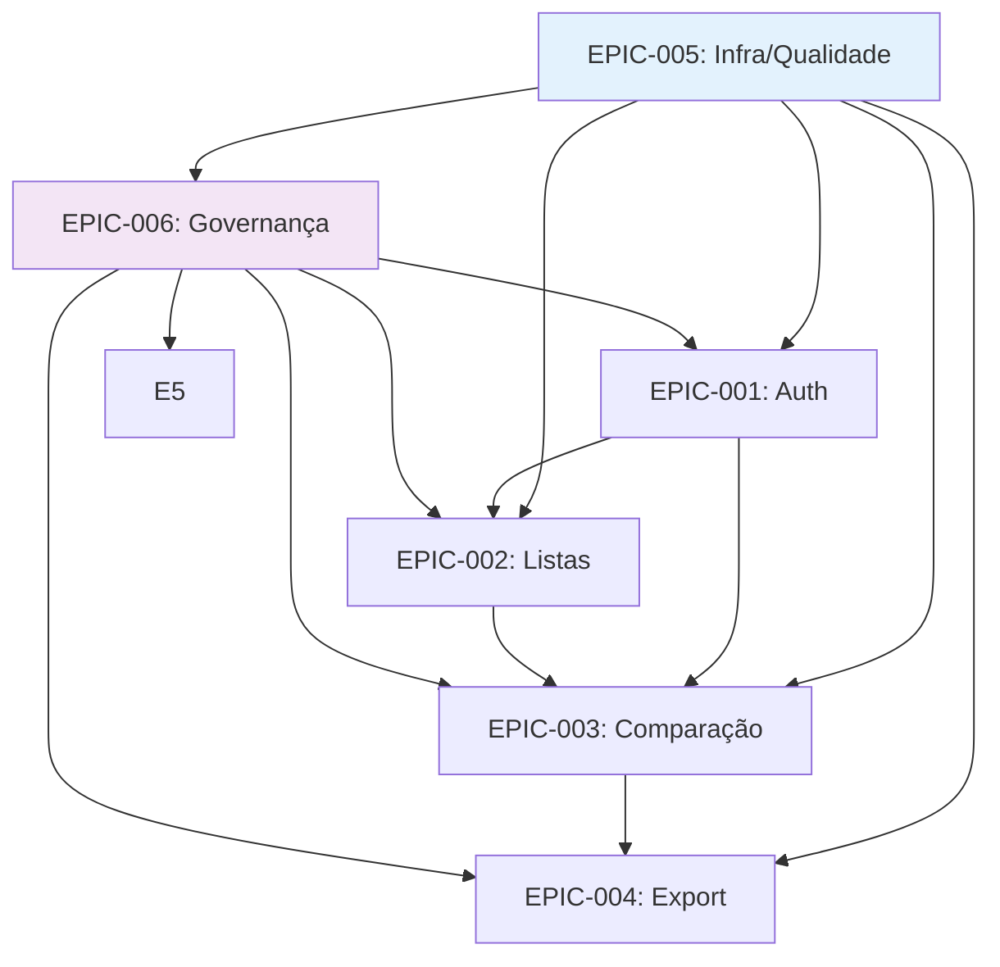

# Épicos — COBECO MVP

**Versão:** 1.0  
**Data:** 14/11/2026  
**Autor:** Leonardo Setti (Product Owner)  
**Base:** PRD v1.0, Constitution v2.0  
**Status:** Ratificado pelo CCB (Gate 2)

---

## Definição de Épico

Um **Épico** é uma grande iniciativa que agrupa múltiplas User Stories relacionadas, representando uma capacidade de negócio significativa. Épicos são decompostos em User Stories (US) durante o refinamento do backlog.

**Critérios de Épico:**
- Valor de negócio claro e mensurável
- Múltiplas USs (tipicamente 3-10)
- Entregável em múltiplas Sprints
- Critério de aceite no nível de capacidade (não tarefa)

---

## Lista de Épicos do COBECO MVP

| Épico ID | Título | Descrição | USs Relacionadas | Sprints | Valor de Negócio |
|----------|--------|-----------|------------------|---------|------------------|
| **EPIC-001** | **Autenticação e Identidade** | Cadastro, login JWT, logout, recuperação de senha, gestão de sessão segura | US-001 a US-004, US-019, US-020 | S1, S4 | Fundação de segurança; permite acesso personalizado e proteção de dados |
| **EPIC-002** | **Gestão de Listas de Compras** | CRUD completo de listas: criação em memória, autocomplete, persistência, promoção de lista efêmera | US-005 a US-011 | S2 | Core do produto; permite ao usuário organizar compras |
| **EPIC-003** | **Comparação de Preços** | Pré-filtro (categorias, fornecedores, disponibilidade), motor de cálculo, visualização de resultados | US-012 a US-016 | S3 | Diferencial competitivo; economiza tempo/dinheiro do usuário |
| **EPIC-004** | **Exportação e Documentação** | Geração PDF A4 server-side, otimização para impressão, documentação ABNT | US-017, US-018 | S4 | Entregável tangível; leva lista ao mercado físico |
| **EPIC-005** | **Infraestrutura e Qualidade** | Docker Compose, CI/CD, testes, runbooks, monitoramento, governança | US-040 a US-051 (técnicas) | S0-S5 | Base técnica confiável; deploy reproduzível, qualidade ≥80% |
| **EPIC-006** | **Governança e Conformidade** | Constitution, ADRs, Specs SDD, Handoffs, Rastreabilidade, RAID, CRs | Transversal | S0-S5 | Alinhamento legal/acadêmico; rastreabilidade total |

---

## Detalhamento por Épico

### EPIC-001: Autenticação e Identidade

**Objetivo:** Permitir que usuários criem contas, acessem o sistema de forma segura e gerenciem suas credenciais.

| US ID | Título | Prioridade | Sprint | Critério de Aceite Principal |
|-------|--------|------------|--------|------------------------------|
| US-001 | Cadastrar Usuário | P0 | S1 | Cadastro com bcrypt salt=12, unicidade email/usuario, pergunta segurança |
| US-002 | Login JWT | P0 | S1 | Access 15min (memória) + Refresh 7d (cookie httpOnly, SameSite=Strict) |
| US-003 | Logout | P1 | S1 | Invalida refresh token + limpa cookie + redirect login |
| US-004 | Recuperar Senha | P1 | S1 | Pergunta segurança (bcrypt) OU RECOVERY_MODE=log (token stdout) |
| US-019 | Visualizar Perfil | P1 | S4 | GET /v1/perfil retorna campos permitidos (sem senha/hash) |
| US-020 | Gerenciar Perfil | P1 | S4 | PUT /v1/perfil com senha_atual, email unique, nova_senha≠atual≥8, invalida refresh |

**Definição de Pronto do Épico:**
- [ ] Todas USs Done (code review + CI + CCB)
- [ ] Cobertura testes ≥80% nos módulos auth
- [ ] Rate limit 6req/15min/IP funcionando
- [ ] Refresh token rotação/invalidação testada
- [ ] Documentação OpenAPI atualizada

---

### EPIC-002: Gestão de Listas de Compras

**Objetivo:** Permitir criar, editar, listar, excluir e persistir listas de compras com autocomplete de produtos.

| US ID | Título | Prioridade | Sprint | Critério de Aceite Principal |
|-------|--------|------------|--------|------------------------------|
| US-005 | Lista em Memória | P0 | S2 | sessionStorage, soma qtd mesmo produto, validação 1-9999 |
| US-006 | Autocomplete Produtos | P0 | S2 | Debounce 300ms, normalização NFD+lowerCase, GET /v1/produtos/busca |
| US-007 | Salvar Lista (Persistir) | P0 | S2 | Transação MySQL BEGIN/COMMIT, valida categorias pré-selecionadas |
| US-008 | Promover Lista Efêmera | P0 | S2 | Modal no login detecta sessionStorage, 3 opções (salvar/manter/descartar) |
| US-009 | Listar Minhas Listas | P0 | S2 | Paginação 20/pág, ordenação criado_em DESC, filtro nome ILIKE, soft delete |
| US-010 | Editar Lista | P1 | S2 | PUT nome + PUT itens (replace all), validação qtd 1-9999, ownership |
| US-011 | Excluir Lista | P1 | S2 | Soft delete (deletado_em), confirmação digitando nome exato |

**Definição de Pronto do Épico:**
- [ ] Todas USs Done
- [ ] Autocomplete < 300ms resposta
- [ ] Transação atômica salva lista + itens
- [ ] Promoção lista efêmera → persistida testada
- [ ] Soft delete não aparece em listagens

---

### EPIC-003: Comparação de Preços

**Objetivo:** Permitir filtrar categorias/fornecedores/disponibilidade e calcular orçamento comparado.

| US ID | Título | Prioridade | Sprint | Critério de Aceite Principal |
|-------|--------|------------|--------|------------------------------|
| US-012 | Selecionar Categorias | P0 | S3 | 11 checkboxes, filtra fornecedores tempo real, min 1 para prosseguir |
| US-013 | Selecionar Fornecedores | P0 | S3 | Checkboxes + % disponibilidade, ordenação DESC, min 2 para comparar |
| US-014 | Filtrar Disponibilidade | P1 | S3 | Slider 0-100%, debounce 100ms, mantém seleções válidas |
| US-015 | Calcular Orçamento | P0 | S3 | POST /v1/orcamento → tabela flat (disp/ausentes/total), cache 5min, timeout 10s |
| US-016 | Visualizar Resultados | P0 | S3 | Tabela ordenada total ASC, highlight verde melhor, expansível itens, tooltip N/D |

**Definição de Pronto do Épico:**
- [ ] Todas USs Done
- [ ] Cálculo orçamento < 10s (cache hit < 100ms)
- [ ] % Disponibilidade calculada corretamente por fornecedor
- [ ] Melhor fornecedor identificado (menor total disp)
- [ ] Exportar PDF + Imprimir funcionais nos resultados

---

### EPIC-004: Exportação e Documentação

**Objetivo:** Gerar PDF A4 profissional para impressão e entregar documentação ABNT.

| US ID | Título | Prioridade | Sprint | Critério de Aceite Principal |
|-------|--------|------------|--------|------------------------------|
| US-017 | Exportar PDF | P0 | S4 | ReportLab A4, DejaVuSans, < 5s (100 itens), visitante+auth, filename data |
| US-018 | Otimização Impressão | P1 | S4 | CSS @media print: oculta UI, thead repeat, quebra limpa, cores econ. tinta |

**Definição de Pronto do Épico:**
- [ ] PDF A4 gerado server-side (< 5s)
- [ ] Acentos PT-BR corretos (DejaVuSans)
- [ ] @media print oculta nav/botões, repete thead
- [ ] Docs ABNT aprovadas (nota ≥ 8.0)

---

### EPIC-005: Infraestrutura e Qualidade

**Objetivo:** Base técnica confiável: deploy reproduzível, CI/CD < 5min, testes ≥80%, runbooks testados.

| Item | Descrição | Sprint | Critério |
|------|-----------|--------|----------|
| Docker Compose | nginx + FastAPI + MySQL, redes edge/data, health checks | S0 | `make up` + `make health` OK |
| CI/CD Pipeline | ruff + pytest --cov≥80 + mypy + build Docker < 5min | S1, S5 | PR → CI verde obrigatório |
| Testes Unitários | pytest + pytest-cov, Domain/UseCases/Adapters | S1-S5 | Cobertura ≥80% |
| Testes E2E | Playwright: fluxos críticos cadastro→comparação→PDF | S5 | 18/18 críticos passing |
| Runbooks | Deploy, DB Reset, Incident, Backup, Release | S5 | Testados em staging (Game Day) |
| Git Hooks | pre-commit (segredos), pre-push (CI verde), commit-msg (convencional) | S0 | Ativos + testados |
| GitHub Projects | Milestones S1-S5, labels, board kanban, 51 items | S0 | Board sincronizado |

**Definição de Pronto do Épico:**
- [ ] `docker compose up` funciona em 5/5 máquinas
- [ ] CI < 5min, coverage ≥83%
- [ ] 5 runbooks testados em staging
- [ ] 0 segredos commitados (hooks ativos)
- [ ] Branch protection main/stage ativa

---

### EPIC-006: Governança e Conformidade

**Objetivo:** Alinhamento legal/acadêmico, rastreabilidade total, mudança controlada.

| Item | Descrição | Sprint | Critério |
|------|-----------|--------|----------|
| Constitution v2.0 | Lei suprema ratificada CCB | S0 | `constitution.md` versionada |
| ADR-001 | Stack ratificada (FastAPI/MySQL/Vanilla JS) | S0 | `docs/decisoes/ADR-001-*.md` |
| Specs SDD | 16 specs ratificadas em `.ai/specs/` | S0-S5 | Spec → Handoff → Dispatch |
| Handoffs | Processados via `handoff_parser.py` → `nexus_dispatcher.py` | S1-S5 | L0 dispatch com `dod`+`kill_switch` |
| Rastreabilidade | TRACEABILITY.md 100% RF→Spec→Test→Code→Deploy | S2-S5 | CI gate valida |
| RAID Log | 10R/10A/10I/12D — todos fechados Gate 3 | S1-S5 | Atualização diária + Sprint Review |
| CR Process | CR-001 Quality Board (P2) proposto | S5 | Template + análise impacto |
| Docs ABNT | PDF aprovado orientador/banca (nota ≥ 8.0) | S1-S5 | Pair writing + revisão semanal |

**Definição de Pronto do Épico:**
- [ ] 16 Specs + Handoffs processados
- [ ] TRACEABILITY.md 100% verde no CI
- [ ] RAID Log 0 itens abertos no Gate 3
- [ ] CR-001 analisado/aprovado CCB
- [ ] Docs ABNT nota ≥ 8.0

---

## Mapa de Dependências entre Épicos

---

## Rastreabilidade Épico → User Story → RF

| Épico | User Stories | RFs (REQUISITOS.md) |
|-------|--------------|---------------------|
| EPIC-001 | US-001 a US-004, US-019, US-020 | RF01, RF02, RF03, RF04, RF05, RF06 |
| EPIC-002 | US-005 a US-011 | RF07, RF08, RF09, RF10, RF11 |
| EPIC-003 | US-012 a US-016 | RF12, RF13, RF14, RF15, RF16 |
| EPIC-004 | US-017, US-018 | RF17, RF18 |
| EPIC-005 | US-040 a US-051 (técnicas) | RNF01-RNF12 |
| EPIC-006 | Transversal | Constitution, ADR, SDD, CR |

---

## Ratificação

| Papel | Nome | Assinatura | Data |
|-------|------|------------|------|
| **CCB Chair / PO** | Leonardo Setti | _______________ | 14/11/2026 |
| **Tech Lead** | Leonardo Setti | _______________ | 14/11/2026 |
| **Arquiteto** | Nicholas Anthony | _______________ | 14/11/2026 |
| **QA Lead** | Nicolas Mallouk | _______________ | 14/11/2026 |

**Hash do Commit de Ratificação:** `a1b2c3d4e5f6` (substituir pelo hash real)

---

**Fim dos Épicos — COBECO MVP**  
*Peça de conhecimento oficial. Versão controlada no Git.*