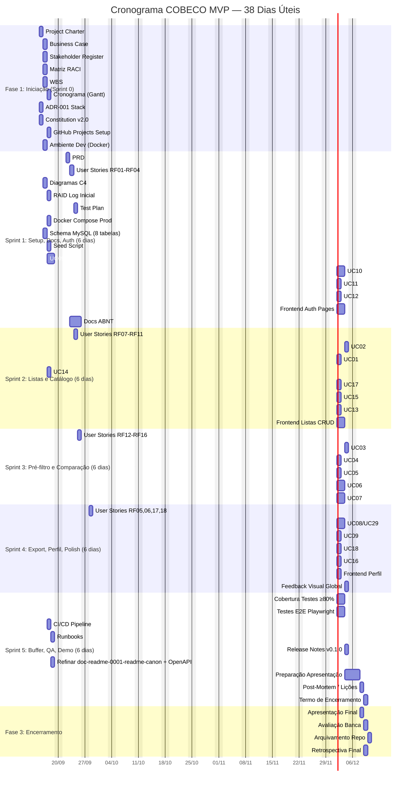
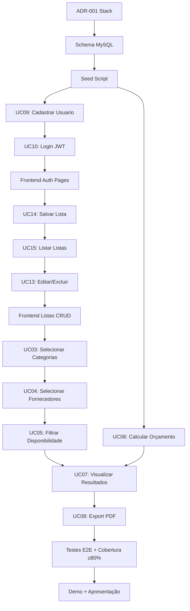

# Cronograma Detalhado (Gantt Simplificado) — COBECO MVP

**Versão:** 1.0  
**Data:** 29/09/2026 (Gate 2)  
**Responsável:** Leonardo Setti (Tech Lead)  
**Ferramenta:** Mermaid.js (versionado no repo)  
**Base:** WBS (`docs/strategy/WBS.md`)

---

## Diagrama de Gantt (Mermaid)

---

## Marcos (Milestones) — Datas Chave

| Marco | Descrição | Data Prevista | Critério de Sdoc-arch-0006-uc-v1esso |
|-------|-----------|---------------|---------------------|
| **M0** | Kick-off + Charter Aprovado | 15/09/2026 | Gate 1: CCB assina Charter + RACI + ADR-001 |
| **M1** | Fim Sprint 1 (Auth + Docs) | 29/09/2026 | Gate 2: PRD + US + C4 + NFRs + Test Plan + RAID aprovados |
| **M2** | Fim Sprint 2 (Listas + Catálogo) | 06/10/2026 | CRUD listas funcional + Autocomplete |
| **M3** | Fim Sprint 3 (Comparação) | 13/10/2026 | Cálculo orçamento + Visualização resultados |
| **M4** | Fim Sprint 4 (Export + Perfil) | 20/10/2026 | PDF A4 + Perfil + UI Polish |
| **M5** | Fim Sprint 5 (QA + Demo) | 27/10/2026 | Gate 3: Cobertura ≥80% + Runbooks + Release + Demo |
| **M6** | Apresentação Final | 30/10/2026 | Gate 4: Banca avalia, Termo de Encerramento assinado |

---

## Dependências Críticas (Caminho Crítico)

**Caminho Crítico Estimado:** ~28 dias (ADR-001 → Demo)  
**Buffer Disponível:** 10 dias (Sprint 5 + Encerramento) = **35% de buffer**

---

## Recursos Alocados por Período

| Período | PO | Tech Lead | Arquiteto | Dev Back 1 | Dev Back 2 | Dev Front | QA | Orientador |
|---------|----|-----------|-----------|------------|------------|-----------|----|------------|
| Sprint 0 (5d) | 50% | 80% | 60% | 40% | 40% | 20% | 10% | 10% |
| Sprint 1 (6d) | 60% | 80% | 40% | 100% | 100% | 80% | 30% | 20% |
| Sprint 2 (6d) | 40% | 60% | 20% | 100% | 80% | 100% | 40% | 10% |
| Sprint 3 (6d) | 30% | 50% | 30% | 100% | 60% | 100% | 50% | 10% |
| Sprint 4 (6d) | 40% | 60% | 20% | 100% | 80% | 100% | 40% | 10% |
| Sprint 5 (6d) | 50% | 80% | 20% | 80% | 80% | 60% | 100% | 30% |
| Encerramento (3d) | 60% | 50% | 10% | 30% | 30% | 30% | 30% | 50% |

---

## Alertas de Cronograma

| Alerta | Gatilho | Ação |
|--------|---------|------|
| **Atraso Sprint 1 > 2 dias** | M1 não atingido em 01/10 | Replanejar Sprint 2-3, cortar escopo P2, CCB decide |
| **Cobertura < 70% no fim Sprint 4** | `pytest --cov` < 70% | Parar features, foco total em testes na Sprint 5 |
| **Integração Front↔Back falha** | Contrato OpenAPI não bate | Parar, alinhar contrato (SDD), RFC se necessário |
| **Membro indisponível > 3 dias** | Bus factor quebrado | Pair programming, redistribuir WBS, CCB avalia prazo |

---

## Controle de Versões

| Versão | Data | Autor | Mudança | Aprovado por |
|--------|------|-------|---------|--------------|
| 1.0 | 29/09/2026 | Leonardo Setti | Criação inicial baseada no WBS | CCB (Gate 2) |

---

**Fim do Cronograma**  
*Renderize o Mermaid no GitHub/GitLab/VS Code para visualização gráfica. Atualizar a cada Sprint Planning.*